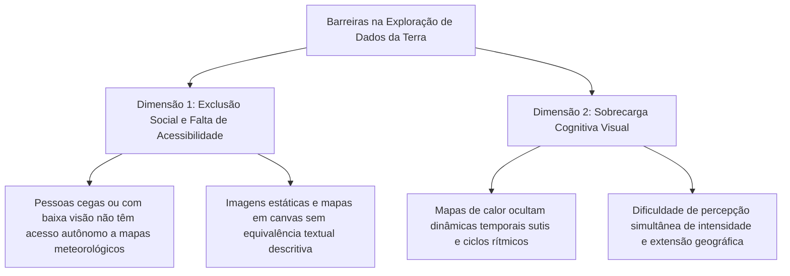

# 01. Visão do Produto

## 1. Contextualização

No cenário contemporâneo de observação da Terra, agências espaciais como a NASA geram petabytes de dados diários por meio de constelações de satélites meteorológicos, climáticos e geofísicos. Iniciativas como o **Earth Information Center (EIC)** e plataformas como o *NASA Worldview* e o *Giovanni* desempenham um papel crucial na divulgação desses conhecimentos.

No entanto, quase a totalidade das interfaces públicas foi construída sob um paradigma exclusivamente visual: mapas temáticos em escala de cores (*colormaps*), animações de satélite em looping e projeções cartográficas 3D interativas. Esse modelo cria uma severa barreira de acessibilidade para indivíduos com deficiência visual e subutiliza as capacidades analíticas cognitivas proporcionadas pelo canal auditivo.

O **SONATLAS** &mdash; cujo slogan é **Explore Earth Through Sound** &mdash; foi desenvolvido no contexto do **NASA Space Apps Challenge 2026** para o desafio **The Earth Information Jukebox**, estabelecendo uma ponte auditiva e científica entre dados brutos de satélite e a experiência sensorial humana.

---

## 2. O Problema Identificado

Podemos categorizar o problema central em duas dimensões complementares:

1. **Exclusão de Acessibilidade Digital:** Mais de 2,2 bilhões de pessoas no mundo vivem com algum grau de deficiência visual (OMS). Na comunidade científica e educacional, o acesso a dados de sensoriamento remoto para esse público é frequentemente mediado por descrições secundárias subjetivas ou totalmente negligenciado.
2. **Saturação e Limitação da Análise Exclusivamente Visual:** A visão humana é excelente para reconhecer formas espaciais estáticas, mas o sistema auditivo humano possui uma resolução temporal superior para identificar transições rítmicas, taxas de aceleração e dispersão temporal que passam despercebidas em gráficos convencionais.

---

## 3. A Oportunidade

A sonificação orientada por dados (*data-driven sonification*) oferece uma oportunidade única de criar uma experiência **multissensorial e inclusiva**:

- A transformação de grandezas geofísicas em propriedades acústicas (frequência fundamental, densidade de pulsos e modulações de ganho) permite que o usuário *escute a chuva* com rigor de medição.
- Permite que estudantes, cientistas e entusiastas compreendam a transição de um sistema convectivo tropical de forma dinâmica e intuitiva.
- Estabelece um paradigma de **Design Universal**, no qual a acessibilidade não é um anexo compensatório, mas o próprio núcleo arquitetural da aplicação.

---

## 4. Proposta de Solução

O **SONATLAS** é uma aplicação web desacoplada e ultra-leve, composta por:

1. **Pipeline Científico em Python:** Realiza a extração de dados do produto **NASA GPM / IMERG V07**, recorte espacial nas regiões de interesse, aplicação de ponderação pela área das células e cálculo de indicadores padronizados em JSON.
2. **Motor de Sonificação Web Audio API:** Síntese sonora paramétrica pura executada diretamente no navegador, sem dependência de streaming de arquivos de áudio pesados, permitindo interatividade em tempo real com latência mínima.
3. **Interface Acessível e Universal:** Plataforma web compatível com leitores de tela (NVDA, JAWS, VoiceOver), navegação completa por teclado, legenda sonora de calibração auditiva e representação cartográfica 2D via Leaflet.

---

## 5. Objetivos do Projeto

### Objetivo Geral
Desenvolver uma plataforma web acessível que converta dados de observação da Terra da NASA em experiências sonoras e visuais interativas, permitindo que qualquer pessoa, com ênfase em pessoas cegas ou com baixa visão, compreenda e explore fenômenos climáticos com rigor científico.

### Objetivos Específicos
- [x] Estabelecer um pipeline de cálculo de indicadores meteorológicos com base no produto NASA GPM IMERG, distinguindo taxa instantânea (`mm/h`) de acumulação (`mm`).
- [x] Mapear a taxa média de precipitação para altura tonal (*pitch*) e a fração de área com chuva para densidade rítmica de pulsos.
- [x] Garantir conformidade com as diretrizes W3C WCAG 2.1 (níveis AA/AAA), assegurando que nenhuma funcionalidade dependa exclusivamente da visão.
- [x] Implementar uma legenda sonora interativa para calibração perceptiva dos usuários.
- [x] Viabilizar a exploração comparativa entre duas regiões climáticas tropicais de grande relevância planetária (Amazônia Central e Região Internacional candidata).

---

## 6. Diferenciais da Solução

| Diferencial | Abordagem Tradicional | Abordagem SONATLAS |
|---|---|---|
| **Canal Primário de Cognição** | 100% visual (mapas coloridos, gráficos 2D/3D). | Auditivo e visual concomitantes, com equivalência não-visual estrita. |
| **Público com Deficiência Visual** | Excluído ou dependente de audiodescrições externas genéricas. | Usuário prioritário: controles acessíveis, anúncios `aria-live` e sons informativos. |
| **Geração do Áudio** | Arquivos MP3/WAV pré-gravados estáticos ou trilhas decorativas. | Síntese paramétrica em tempo real via Web Audio API guiada por métricas físicas. |
| **Tratamento de Incertezas** | Nulos frequentemente mascarados como zero ou omitidos. | Dados ausentes (*missing data*) destacados acusticamente com tom de alerta neutro. |
| **Infraestrutura e Dependências** | Bancos de dados pesados, servidores em nuvem com alta latência. | Arquitetura estática desacoplada ultra-rápida, executável diretamente no browser. |

---

## 7. Público-Alvo

1. **Pessoas cegas ou com baixa visão:** Usuários que dependem de leitores de tela e tecnologias assistivas para explorar conteúdos digitais.
2. **Estudantes do Ensino Fundamental, Médio e Superior:** Jovens e universitários em busca de ferramentas interdisciplinares dinâmicas para o aprendizado de climatologia e física.
3. **Educadores e Divulgadores Científicos:** Professores de ciências, física e geografia que necessitam de recursos pedagógicos inclusivos em sala de aula.
4. **Pesquisadores e Entusiastas da Ciência Cidadã:** Profissionais interessados em exploração multissensorial de dados de observação da Terra.

---

## 8. Escopo do Produto e Limites do MVP

### O que ESTÁ no escopo do MVP:
- Fenômeno focal: **Precipitação atmosférica**.
- Regiões de estudo: **Amazônia Central** (Nacional) e **Região Internacional candidata** (Bacia do Congo em avaliação técnica, sem dados fictícios).
- Suíte de dados: **NASA GPM / IMERG V07** como fonte candidata.
- Player temporal (*Jukebox*) com controles de Play, Pause, Avançar passo, Retroceder passo e Silenciar.
- Indicadores exibidos: taxa média de precipitação ($\text{mm/h}$), cobertura de área com chuva ($\%$) e variabilidade temporal ($\Delta R$).
- Legenda sonora interativa para calibração de modelos mentais acústicos.
- Mapa 2D de apoio com camada GeoJSON e alternativa textual integral.

### O que NÃO ESTÁ no escopo do MVP (Limitações Intencionais):
- Autenticação de usuários, perfis ou cadastro.
- Banco de dados relacional ou NoSQL em servidor.
- Módulos de inteligência artificial generativa para geração de trilhas musicais.
- Visualizações em globo 3D ou renderizações WebGL complexas.
- Inclusão simultânea de outros fenômenos climáticos (ex: temperatura, vento, ozônio).
- Composição musical orquestral ou polifonia artística complexa (a meta é sonificação científica clara e informativa).
