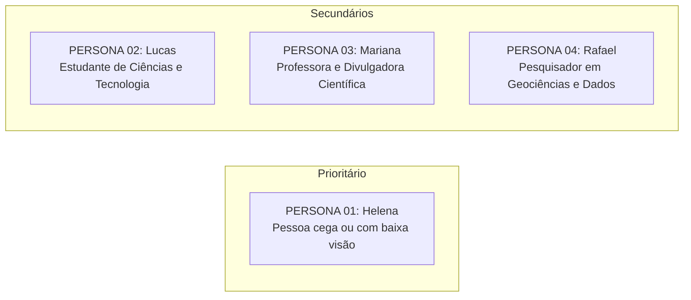

# 02. Personas e Usuários

> **Nota Metodológica Obrigatória:**  
> As personas descritas neste documento são **representações arquetípicas hipotéticas** desenvolvidas para orientar as decisões de engenharia de software, priorização de requisitos, design de interação e acessibilidade do SONATLAS. Elas não representam resultados empíricos de pesquisas de campo já concluídas, devendo ser validadas ao longo do ciclo de vida do produto.

---

## 1. Visão Geral dos Perfis de Usuário

Para assegurar que o desenvolvimento do SONATLAS atenda com excelência tanto à acessibilidade universal quanto à fidelidade científica, estruturamos quatro personas hipotéticas complementares:

---

## 2. PERSONA 01 — Helena (Público Prioritário)

  
Persona 01 &bull; Público Prioritário de Acessibilidade

  
Helena &bull; Pessoa cega ou com baixa visão

  

    <strong>Perfil:</strong> Usuária ativa de tecnologia assistiva digital e leitora assídua de conteúdos científicos e culturais acessíveis. 
    <strong>Tecnologias Utilizadas:</strong> Leitores de tela (NVDA no desktop e VoiceOver no smartphone); navegação 100% via teclado. 
    <strong>Motivação:</strong> Acessar informações meteorológicas e climáticas globais com autonomia e sem intermediação visual.
  

### Necessidades Principais
- **Independência do Mapa Visual:** Explorar e selecionar regiões territoriais por meio de alternativas textuais semânticas estruturadas.
- **Interação Fluida com Leitores de Tela:** Navegar por todos os botões, controles de linha do tempo e seletores com anúncios precisos via `aria-live`.
- **Compreensão Intuitiva dos Sons:** Dispor de uma **Legenda Sonora** interativa para calibrar seu modelo mental acústico antes de ouvir séries complexas.
- **Controle Total da Reprodução:** Pausar, retroceder, avançar passo a passo e repetir trechos sonoros sem restrições.

### Dificuldades e Barreiras Enfrentadas
- Plataformas tradicionais que apresentam mapas em `<canvas>` ou imagens PNG sem audiodescrição ou texto equivalente.
- Falta de controle temporal nos áudios, forçando o usuário a ouvir arquivos longos sem poder pausar no ponto desejado.
- Confusão auditiva entre "ausência de dados de satélite" e "ausência de chuva" quando a plataforma não sinaliza erros instrumentais.

### Cenário de Uso Típico
Helena acessa a aplicação via navegador utilizando o leitor de tela NVDA. Por meio da tecla `Tab`, ela salta o cabeçalho e acessa a **Legenda Sonora**, onde clica nos botões de teste para ouvir a diferença entre chuva fraca, chuva moderada e tempestade severa. Em seguida, seleciona a Amazônia Central pelo seletor textual acessível, pressiona a barra de espaço para iniciar o reprodutor e acompanha a dinâmica da precipitação pelo áudio, ouvindo simultaneamente as audiodescrições em linguagem natural.

---

## 3. PERSONA 02 — Lucas (Estudante)

  
Persona 02 &bull; Educação e Engajamento Científico

  
Lucas &bull; Estudante interessado em ciências e tecnologia

  

    <strong>Perfil:</strong> Aluno do Ensino Médio / Iniciação Científica Júnior, apaixonado por física, astronomia e programação. 
    <strong>Tecnologias Utilizadas:</strong> Laptop pessoal e smartphone; familiarizado com interfaces web modernas e dinâmicas. 
    <strong>Motivação:</strong> Encontrar ferramentas interativas para compreender fenômenos atmosféricos e preparar apresentações escolares.
  

### Necessidades Principais
- **Compreensão de Fenômenos Terrestres:** Entender como tempestades tropicais se formam e se dissipam no espaço e no tempo.
- **Exploração Interativa:** Relacionar a intensidade da chuva expressa em milímetros por hora (`mm/h`) com a frequência sonora emitida.
- **Sincronização Multissensorial:** Ver o mapa 2D destacar a região enquanto escuta a evolução dos pulsos sonoros.

### Dificuldades e Barreiras Enfrentadas
- Artigos e portais científicos com terminologia densa, tabelas estáticas frias e gráficos de difícil interpretação.
- Falta de contextualização sobre o impacto real dos números e das taxas de precipitação.

### Cenário de Uso Típico
Lucas utiliza o SONATLAS durante um trabalho sobre o ciclo hidrológico da Amazônia. Ele conecta o fone de ouvido, seleciona a série temporal e percebe nitidamente pelo aumento do *pitch* (som agudo) e aceleração dos pulsos como uma linha de instabilidade tropical atinge seu pico convectivo.

---

## 4. PERSONA 03 — Mariana (Educadora / Divulgadora Científica)

  
Persona 03 &bull; Prática Pedagógica Inclusiva

  
Mariana &bull; Professora e divulgadora científica

  

    <strong>Perfil:</strong> Docente de Ciências / Geografia no Ensino Fundamental e Médio, coordenadora de feiras científicas escolares. 
    <strong>Tecnologias Utilizadas:</strong> Projetores multimídia, computadores e plataformas educacionais digitais. 
    <strong>Motivação:</strong> Promover dinâmicas inclusivas em sala de aula onde alunos videntes e com deficiência visual participem com igualdade cognitiva.
  

### Necessidades Principais
- **Recurso Didático Inclusivo:** Ensinar conceitos de ondas sonoras, climatologia e sensoriamento remoto de forma tangível e integrada.
- **Controles Didáticos Precisos:** Poder congelar um instante da série temporal para debater com a turma o que aquele som representa.
- **Rigor Terminológico:** Garantia de que a plataforma diferencie explicitamente taxa de precipitação (`mm/h`) de precipitação acumulada (`mm`).

### Dificuldades e Barreiras Enfrentadas
- Escassez de ferramentas pedagógicas digitais que contemplem estudantes cegos no ensino de ciências exatas e da Terra.
- Plataformas que utilizam efeitos sonoros puramente fantasiosos sem correspondência matemática com os dados.

### Cenário de Uso Típico
Mariana projeta o SONATLAS na sala de aula e pede aos alunos que fechem os olhos por dois minutos para escutarem a sonificação da Amazônia Central. Ela pausa a reprodução no terceiro passo e conduz uma discussão sobre como a densidade de pulsos permitiu inferir a porcentagem de área coberta pela chuva.

---

## 5. PERSONA 04 — Rafael (Pesquisador / Analista de Dados)

  
Persona 04 &bull; Rigor Científico e Validação

  
Rafael &bull; Pesquisador interessado em dados de observação da Terra

  

    <strong>Perfil:</strong> Geógrafo e pesquisador de pós-graduação em meteorologia tropical e sensoriamento remoto por satélite. 
    <strong>Tecnologias Utilizadas:</strong> Python, GIS, dados NetCDF/HDF5 e ferramentas de exploração analítica. 
    <strong>Motivação:</strong> Avaliar métodos não visuais para triagem rápida de grandes volumes de séries temporais de precipitação.
  

### Necessidades Principais
- **Transparência de Fontes:** Identificar com precisão o produto da NASA (GPM IMERG V07), resolução espacial ($0.1^\circ$) e versão do algoritmo.
- **Rastreabilidade Metodológica:** Compreender a função de agregação espacial (ponderação pelo cosseno da latitude) e o limiar de detecção ($0.1 \text{ mm/h}$).
- **Integridade de Dados:** Garantir que passos com dados ausentes (*missing*) não sejam mascarados ou imputados como zero.

### Dificuldades e Barreiras Enfrentadas
- Ferramentas de divulgação científica que modificam ou interpolam dados sem documentar os limites e flags de qualidade.
- Ausência de metadados explícitos sobre o fuso horário (UTC) e janelas temporais de coleta.

### Cenário de Uso Típico
Rafael consulta a documentação metodológica do SONATLAS, inspeciona o dicionário de dados JSON e verifica que as grandezas físicas respeitam os padrões do produto GPM IMERG. Ele utiliza o player para identificar momentos de anomalia na série temporal e constata a consistência entre a taxa física calculada e a resposta sonora gerada.
