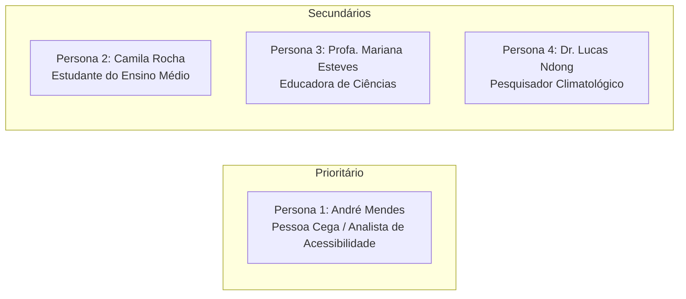

# 02. Personas e Usuários

> **Nota Metodológica Obrigatória:**  
> As personas descritas neste documento são **representações arquetípicas hipotéticas** desenvolvidas para guiar decisões de arquitetura de software, design de interação e requisitos de acessibilidade do SONATLAS. Elas não representam resultados empíricos de entrevistas ou pesquisas com usuários reais já concluídas pela equipe.

---

## 1. Visão Geral dos Perfis de Usuário

Para assegurar que o desenvolvimento atenda tanto ao rigor científico quanto à acessibilidade universal, definimos quatro personas hipotéticas divididas em **público prioritário** e **públicos secundários**:

---

## 2. Persona 1 (Prioritária): Pessoa Cega / Usuário de Tecnologia Assistiva

  
Persona 01 &bull; Público Prioritário

  
André Mendes, 29 anos

  

    <strong>Ocupação:</strong> Analista de Acessibilidade Digital e entusiasta de astronomia e climatologia. 
    <strong>Localização:</strong> São Paulo, Brasil. 
    <strong>Tecnologias Assistivas:</strong> Leitor de tela NVDA (Windows) e VoiceOver (iOS); navegação estritamente via teclado.
  

### Contexto de Uso
André tem grande paixão por ciência e acompanha os lançamentos da NASA. No entanto, frustra-se com frequência porque as plataformas científicas disponibilizam dados através de mapas de calor visuais inacessíveis (`colormaps`), imagens PNG sem descrições alternativas semânticas e gráficos sem árvores de acessibilidade.

### Objetivos de Utilização
- Compreender a variação temporal de eventos de tempestade e estiagem na Amazônia de forma autônoma.
- Explorar dados científicos através de áudio que traduza dados reais, e não simples efeitos sonoros ilustrativos ou decorativos.

### Necessidades Principais
- Navegação fluida e sem atalhos conflitantes usando a tecla `Tab` e setas.
- Anúncios concisos e discretos via `aria-live`, sem repetições irritantes a cada segundo.
- Legenda sonora para treinar seu modelo mental antes de iniciar a reprodução da série completa.

### Dificuldades e Dores Enfrentadas
- Elementos `<canvas>` ou gráficos SVG inacessíveis sem texto estruturado equivalente.
- Interfaces que travam o leitor de tela ou exigem clique de mouse para interagir.
- Sons agudos estridentes ou frequências desconfortáveis que causam fadiga auditiva precoce.

### Cenário de Uso Hipotético
André acessa o SONATLAS usando o leitor de tela NVDA. Ele escuta o anúncio de boas-vindas, pula diretamente para a Legenda Sonora através do atalho de salto (*skip-link*), testa o som de uma "chuva fraca" e de uma "tempestade severa". Em seguida, seleciona a Amazônia Central, aciona a barra de espaço para iniciar a reprodução e consegue discernir com nitidez o momento exato em que a tempestade atinge o pico convectivo.

---

## 3. Persona 2 (Secundária): Estudante

  
Persona 02 &bull; Educação Básica / Superior

  
Camila Rocha, 17 anos

  

    <strong>Ocupação:</strong> Estudante do 3º ano do Ensino Médio. 
    <strong>Localização:</strong> Manaus, Amazonas, Brasil. 
    <strong>Perfil Tecnológico:</strong> Nativa digital em smartphones e notebooks; prefere experiências multissensoriais dinâmicas.
  

### Contexto de Uso
Camila está preparando um trabalho escolar interdisciplinar de Geografia e Física sobre a importância da Bacia Amazônica na distribuição de umidade continental e procura fontes inovadoras da NASA para apresentar à turma.

### Objetivos de Utilização
- Apresentar um projeto interativo e envolvente que surpreenda seus colegas e professores.
- Ouvir a dinâmica da chuva em sua própria região (Amazônia Central) e relacionar a frequência sonora com a intensidade física.

### Necessidades Principais
- Interface responsiva, rápida e intuitiva que funcione sem instalação prévia no navegador.
- Explicações claras e diretas sobre as grandezas físicas (o que significa uma taxa de 15 mm/h).
- Controles visuais atraentes que sincronizem o avanço do mapa com o som emitido.

### Dificuldades e Dores Enfrentadas
- Portais científicos oficiais com linguagem hermética e navegação truncada voltada apenas para doutores.
- Dificuldade em visualizar dados de satélite de forma atraente para apresentações escolares.

### Cenário de Uso Hipotético
Camila conecta seu notebook ao projetor e à caixa de som da sala de aula. Ao reproduzir o SONATLAS, ela demonstra aos colegas como a passagem de uma linha de instabilidade tropical sobre a Amazônia pode ser percebida como uma aceleração rítmica e elevação do tom acústico.

---

## 4. Persona 3 (Secundária): Educadora / Divulgadora Científica

  
Persona 03 &bull; Divulgação Científica

  
Profa. Dra. Mariana Esteves, 42 anos

  

    <strong>Ocupação:</strong> Professora de Ciências e Coordenadora de Feira de Ciências no Ensino Fundamental. 
    <strong>Localização:</strong> Belo Horizonte, Minas Gerais, Brasil. 
    <strong>Perfil Tecnológico:</strong> Usuária experiente de plataformas de ensino e ferramentas multimídia.
  

### Contexto de Uso
Mariana planeja atividades pedagógicas integradas entre Física (acústica e ondas), Geografia (climatologia e sensoriamento remoto) e Cidadania (inclusão de alunos com deficiência visual na sala de aula regular).

### Objetivos de Utilização
- Utilizar a sonificação como recurso didático para ensinar que som é informação e onda física.
- Promover uma atividade inclusiva onde estudantes com e sem deficiência visual colaborem no mesmo nível de percepção.

### Necessidades Principais
- Rastreabilidade e fundamentação teórica: saber exatamente de onde vêm os dados (GPM IMERG) e como foram processados.
- Controle passo a passo: poder pausar a qualquer instante, inspecionar a observação e debater com os estudantes.
- Diferenciação clara entre taxa de precipitação instantânea (`mm/h`) e acumulação total (`mm`).

### Dificuldades e Dores Enfrentadas
- Softwares educativos que simplificam excessivamente os dados científicos ou usam simulações irreais.
- Escassez de ferramentas acessíveis para demonstrar ciências da Terra a estudantes cegos.

### Cenário de Uso Hipotético
Mariana propõe uma dinâmica em aula onde todos os estudantes vendam os olhos por alguns minutos e escutam a série temporal do SONATLAS. Ao final, pede que desenhem ou descrevam em que instante a chuva esteve mais concentrada, revelando a eficácia do canal auditivo na interpretação científica.

---

## 5. Persona 4 (Secundária): Pesquisador / Analista Ambiental

  
Persona 04 &bull; Especialista em Geociências

  
Dr. Lucas Ndong, 36 anos

  

    <strong>Ocupação:</strong> Pesquisador em Hidrologia Tropical e Sensoriamento Remoto. 
    <strong>Localização:</strong> Libreville, Gabão / Cooperação Internacional. 
    <strong>Perfil Tecnológico:</strong> Especialista em Python, GIS, dados NetCDF/HDF5 e computação em nuvem.
  

### Contexto de Uso
Lucas realiza estudos comparativos do regime pluviométrico entre bacias florestais tropicais equatoriais (Bacia Amazônica e Bacia do Congo) e tem interesse em metodologias de Análise Exploratória de Dados (*Exploratory Data Analysis - EDA*) alternativas à visualização comum.

### Objetivos de Utilização
- Avaliar a viabilidade da sonificação como ferramenta rápida para triagem de anomalias ou descontinuidades temporais em grandes volumes de dados.
- Verificar a integridade metodológica do tratamento de dados geoespaciais e ausência de dados no pipeline.

### Necessidades Principais
- Dicionário de dados formal com metadados claros (versão do produto, satélite, flags de qualidade).
- Garantia de que a plataforma não inventa ou interpola dados sem registrar o indicador de validade.
- Acesso à documentação da metodologia de ponderação da área pela latitude.

### Dificuldades e Dores Enfrentadas
- Interfaces de demonstração que ocultam dados faltantes (*missing values*) ou os convertem em zero sem avisar.
- Falta de padronização nas unidades de medida entre diferentes ferramentas de satélite.

### Cenário de Uso Hipotético
Lucas inspeciona a documentação técnica do SONATLAS, revisa o arquivo `data-dictionary.md`, analisa a ponderação cosseno adotada no pipeline Python e constata que a ferramenta respeita as premissas físicas do produto GPM IMERG.
