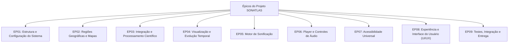

# 04. Histórias de Usuário (User Stories)

As histórias de usuário do SONATLAS conectam as necessidades das personas aos requisitos do sistema e aos épicos de desenvolvimento. Cada história segue o formato ágil padrão, com critérios de aceitação objetivos e testáveis.

---

## 1. Mapeamento de Épicos (EP01 a EP09)

---

## 2. Histórias de Usuário Detalhadas (US01 a US20)

### US01 — Conhecer o SONATLAS
- **Título:** Apresentação da Plataforma e Missão Científica.
- **Épico:** EP08 — Experiência e interface do usuário.
- **Persona:** Lucas (Estudante) / Mariana (Professora).
- **Descrição:** **Como** usuário visitante, **quero** compreender a proposta e o objetivo do SONATLAS na página inicial, **para que** eu saiba como utilizar a plataforma e entender sua relevância inclusiva.
- **Requisito Relacionado:** RF01.
- **Prioridade:** **Alta**.
- **Critérios de Aceitação:**
  1. A página inicial exibe o nome SONATLAS, o slogan *"Explore Earth Through Sound"* e menção ao *NASA Space Apps Challenge 2026*.
  2. Apresentação sucinta explicando a conversão de dados de satélite da NASA em som e visão.
  3. Presença de botões de acesso rápido para iniciar a exploração ou abrir o guia de atalhos.
- **Dependências:** Nenhuma.
- **Status Inicial:** **Concluído**.

---

### US02 — Conhecer as Regiões Disponíveis
- **Título:** Visualização do Catálogo de Regiões de Estudo.
- **Épico:** EP02 — Regiões geográficas e mapas.
- **Persona:** Lucas (Estudante) / Rafael (Pesquisador).
- **Descrição:** **Como** usuário explorador, **quero** visualizar quais regiões de estudo estão disponíveis na plataforma, **para que** eu possa escolher qual bioma desejo investigar.
- **Requisito Relacionado:** RF02.
- **Prioridade:** **Alta**.
- **Critérios de Aceitação:**
  1. O seletor de regiões lista claramente a Amazônia Central (Brasil) e a Região Internacional (Bacia do Congo).
  2. A região internacional candidata exibe identificador visual e textual informando *"Área candidata sob validação"*.
- **Dependências:** US01.
- **Status Inicial:** **Concluído**.

---

### US03 — Selecionar uma Região
- **Título:** Alternância Acessível de Regiões.
- **Épico:** EP02 — Regiões geográficas e mapas.
- **Persona:** Helena (Pessoa cega ou com baixa visão).
- **Descrição:** **Como** usuário, **quero** selecionar uma região por meio do mapa 2D ou de uma alternativa textual acessível, **para que** os dados da área escolhida sejam carregados imediatamente.
- **Requisito Relacionado:** RF03, RF13.
- **Prioridade:** **Crítica**.
- **Critérios de Aceitação:**
  1. O controle de seleção textual (`<select>`) é 100% navegável via teclado (`Tab` e setas direcionais).
  2. Ao selecionar uma nova região, os dados temporais são carregados sem recarregar a página inteira.
  3. O leitor de tela anuncia a alteração via `aria-live`.
- **Dependências:** US02.
- **Status Inicial:** **Concluído**.

---

### US04 — Consultar Informações da Região
- **Título:** Exibição de Metadados e Delimitação Territorial.
- **Épico:** EP02 — Regiões geográficas e mapas.
- **Persona:** Rafael (Pesquisador).
- **Descrição:** **Como** usuário, **quero** conhecer a área geográfica selecionada e suas características territoriais, **para que** eu compreenda a escala espacial da amostragem.
- **Requisito Relacionado:** RF04, RF17.
- **Prioridade:** **Média**.
- **Critérios de Aceitação:**
  1. O mapa 2D Leaflet renderiza a *bounding box* da região a partir de arquivo GeoJSON padronizado.
  2. Abaixo do mapa, um texto acessível descreve as coordenadas extremas em latitude e longitude.
- **Dependências:** US03.
- **Status Inicial:** **Concluído**.

---

### US05 — Consultar Observações Científicas
- **Título:** Acesso às Observações da Série Temporal.
- **Épico:** EP03 — Integração e processamento de dados científicos.
- **Persona:** Rafael (Pesquisador) / Lucas (Estudante).
- **Descrição:** **Como** usuário, **quero** acessar a lista de observações de precipitação da região selecionada, **para que** eu acompanhe a sequência cronológica dos eventos.
- **Requisito Relacionado:** RF05, RF06.
- **Prioridade:** **Alta**.
- **Critérios de Aceitação:**
  1. A série temporal carrega ordenadamente pelo timestamp UTC.
  2. A interface informa a quantidade total de observações disponíveis no dataset.
- **Dependências:** US03.
- **Status Inicial:** **Concluído**.

---

### US06 — Compreender os Indicadores
- **Título:** Consulta Estruturada a Indicadores Físicos.
- **Épico:** EP03 — Integração e processamento de dados científicos.
- **Persona:** Lucas (Estudante) / Mariana (Professora).
- **Descrição:** **Como** usuário, **quero** consultar os indicadores científicos com unidades padronizadas, **para que** eu entenda as grandezas físicas representadas no som.
- **Requisito Relacionado:** RF07, RNF06.
- **Prioridade:** **Crítica**.
- **Critérios de Aceitação:**
  1. A taxa média de precipitação é exibida rigorosamente na unidade `mm/h`.
  2. A cobertura de área com chuva é expressa em porcentagem (`%`) baseada no limiar de $0.1 \text{ mm/h}$.
  3. A variação temporal ($\Delta R$) é indicada em relação à observação anterior.
- **Dependências:** US05.
- **Status Inicial:** **Concluído**.

---

### US07 — Explorar a Evolução Temporal
- **Título:** Navegação Interativa na Linha do Tempo.
- **Épico:** EP04 — Visualização e evolução temporal.
- **Persona:** Lucas (Estudante) / Rafael (Pesquisador).
- **Descrição:** **Como** usuário, **quero** navegar entre observações temporais por meio de botões de passo e linha do tempo, **para que** eu perceba as mudanças da precipitação ao longo das horas.
- **Requisito Relacionado:** RF08.
- **Prioridade:** **Alta**.
- **Critérios de Aceitação:**
  1. Cada botão da linha do tempo exibe o horário formatado em UTC e o valor de taxa.
  2. O passo ativo recebe destaque visual e atributo `aria-current="step"`.
  3. Navegar com as setas do teclado esquerda/direita avança e retrocede o passo instantaneamente.
- **Dependências:** US05.
- **Status Inicial:** **Concluído**.

---

### US08 — Ouvir a Sonificação
- **Título:** Conversão Acústica de Dados em Tempo Real.
- **Épico:** EP05 — Motor de sonificação.
- **Persona:** Helena (Pessoa cega ou com baixa visão) / Lucas (Estudante).
- **Descrição:** **Como** usuário, **quero** ouvir a transformação dos dados científicos em som, **para que** eu compreenda o fenômeno meteorológico por meio da audição.
- **Requisito Relacionado:** RF09.
- **Prioridade:** **Crítica**.
- **Critérios de Aceitação:**
  1. Chuva mais intensa (maior mm/h) produz frequência fundamental mais aguda (220 Hz a 880 Hz).
  2. Maior proporção de área chuvosa produz maior quantidade de pulsos rítmicos por intervalo (1 a 7 pulsos).
  3. O áudio é sintetizado em tempo real via Web Audio API com latência imperceptível (< 50 ms).
- **Dependências:** US06.
- **Status Inicial:** **Concluído**.

---

### US09 — Controlar a Reprodução
- **Título:** Painel de Controles do Jukebox Sonoro.
- **Épico:** EP06 — Player e controles de áudio.
- **Persona:** Helena (Pessoa cega ou com baixa visão) / Mariana (Professora).
- **Descrição:** **Como** usuário, **quero** controlar a reprodução do áudio (tocar, pausar, avançar e silenciar), **para que** eu explore a experiência no meu próprio ritmo.
- **Requisito Relacionado:** RF10.
- **Prioridade:** **Crítica**.
- **Critérios de Aceitação:**
  1. O botão Play/Pause alterna o estado de reprodução imediatamente com a tecla `Espaço`.
  2. Botões de passo anterior e próximo passo avançam a sequência temporal.
  3. Botão de Mute (tecla `M`) silencia o som sem parar o fluxo da linha do tempo.
- **Dependências:** US08.
- **Status Inicial:** **Concluído**.

---

### US10 — Compreender a Legenda Sonora
- **Título:** Calibração Psicoacústica Interativa.
- **Épico:** EP05 — Motor de sonificação.
- **Persona:** Helena (Pessoa cega ou com baixa visão) / Mariana (Professora).
- **Descrição:** **Como** usuário, **quero** conhecer o significado dos sons por meio de uma legenda sonora interativa, **para que** eu interprete corretamente as grandezas físicas representadas.
- **Requisito Relacionado:** RF11.
- **Prioridade:** **Alta**.
- **Critérios de Aceitação:**
  1. Botões dedicados para testar isoladamente: "Chuva Leve / Localizada", "Chuva Moderada", "Tempestade Severa" e "Aviso de Dado Ausente".
  2. Cada botão toca amostra de 1.5s com envoltória ADSR suave e descrição textual da frequência e pulsos.
- **Dependências:** US08.
- **Status Inicial:** **Concluído**.

---

### US11 — Consultar Explicações Textuais
- **Título:** Audiodescrição Estruturada em Linguagem Natural.
- **Épico:** EP07 — Acessibilidade.
- **Persona:** Helena (Pessoa cega ou com baixa visão).
- **Descrição:** **Como** usuário, **quero** visualizar uma explicação textual clara dos indicadores, **para que** a experiência sonora seja complementada por contexto verbal inteligível.
- **Requisito Relacionado:** RF12.
- **Prioridade:** **Alta**.
- **Critérios de Aceitação:**
  1. Cada observação possui um bloco de audiodescrição explicando o fenômeno em linguagem natural (ex: *"Precipitação moderada com taxa média de 4.6 mm/h cobrindo 45% da área"*).
  2. O texto é atualizado dinamicamente a cada passo da linha do tempo.
- **Dependências:** US06.
- **Status Inicial:** **Concluído**.

---

### US12 — Navegar sem Utilizar o Mapa
- **Título:** Independência Visual Completa.
- **Épico:** EP07 — Acessibilidade.
- **Persona:** Helena (Pessoa cega ou com baixa visão).
- **Descrição:** **Como** pessoa cega ou com baixa visão, **quero** operar todas as funções da plataforma sem depender do mapa cartográfico, **para que** eu tenha igualdade de acesso a 100% da informação.
- **Requisito Relacionado:** RF03, RF13, RNF01.
- **Prioridade:** **Crítica**.
- **Critérios de Aceitação:**
  1. Elementos puramente visuais do mapa Leaflet possuem `aria-hidden="true"`.
  2. Toda a seleção regional e leitura métrica possui equivalente textual e auditivo direto.
- **Dependências:** US03, US11.
- **Status Inicial:** **Concluído**.

---

### US13 — Utilizar Leitores de Tela
- **Título:** Compatibilidade Estrita com Tecnologias Assistivas.
- **Épico:** EP07 — Acessibilidade.
- **Persona:** Helena (Pessoa cega ou com baixa visão).
- **Descrição:** **Como** pessoa cega que utiliza leitores de tela (NVDA/JAWS/VoiceOver), **quero** navegar pelos controles com retorno audível limpo, **para que** eu entenda as ações executadas sem sobrecarga auditiva.
- **Requisito Relacionado:** RF13, RNF01.
- **Prioridade:** **Crítica**.
- **Critérios de Aceitação:**
  1. Uso de uma região `aria-live="polite"` centralizada para anunciar passos e mudanças de estado.
  2. Botões com atributos `aria-label` descritivos e sem dependência de ícones visuais para identificação.
- **Dependências:** US09.
- **Status Inicial:** **Concluído**.

---

### US14 — Receber Informações sobre Dados Indisponíveis
- **Título:** Tratamento Acústico e Visual de Dados Ausentes (*Missing Data*).
- **Épico:** EP03 — Integração e processamento de dados científicos.
- **Persona:** Rafael (Pesquisador) / Helena (Pessoa cega).
- **Descrição:** **Como** usuário, **quero** ser informado com clareza quando uma observação não possuir dados de satélite, **para que** eu não confunda ausência de dados com precipitação zero.
- **Requisito Relacionado:** RF14, RN01.
- **Prioridade:** **Crítica**.
- **Critérios de Aceitação:**
  1. Observações sem dados exibem badge de alerta e valor `null` (nunca `0.0 mm/h`).
  2. O motor de som emite um tom característico de advertência (onda triangular dissonante).
  3. O leitor de tela anuncia: *"Dados não disponíveis para este intervalo"*.
- **Dependências:** US06, US08.
- **Status Inicial:** **Concluído**.

---

### US15 — Conhecer as Fontes Científicas
- **Título:** Rastreabilidade e Transparência Metodológica.
- **Épico:** EP03 — Integração e processamento de dados científicos.
- **Persona:** Rafael (Pesquisador).
- **Descrição:** **Como** pesquisador, **quero** consultar a origem dos dados e sua metodologia de tratamento, **para que** eu possa avaliar a confiabilidade científica das informações.
- **Requisito Relacionado:** RF15, RNF07.
- **Prioridade:** **Média**.
- **Critérios de Aceitação:**
  1. Identificação clara da missão NASA GPM / produto IMERG V07 e repositório GES DISC.
  2. Link direto no rodapé e no sumário para o portal de documentação metodológica.
- **Dependências:** US01.
- **Status Inicial:** **Concluído**.

---

### US16 — Explorar uma Segunda Região
- **Título:** Expansão da Amostragem Internacional.
- **Épico:** EP02 — Regiões geográficas e mapas.
- **Persona:** Lucas (Estudante) / Rafael (Pesquisador).
- **Descrição:** **Como** usuário, **quero** selecionar uma segunda região de estudo internacional, **para que** eu amplie minha exploração geográfica para além da Amazônia.
- **Requisito Relacionado:** RF02, RN05.
- **Prioridade:** **Média** (Expansão planejada).
- **Critérios de Aceitação:**
  1. A Bacia do Congo é apresentada com aviso explícito de área sob validação técnica.
  2. A estrutura de dados carrega o arquivo placeholder correspondente sem gerar erros na interface.
- **Dependências:** US03.
- **Status Inicial:** **Em Validação**.

---

### US17 — Comparar Regiões
- **Título:** Comparação Científica de Regiões Tropicais.
- **Épico:** EP08 — Experiência e interface do usuário.
- **Persona:** Rafael (Pesquisador) / Lucas (Estudante).
- **Descrição:** **Como** usuário, **quero** comparar indicadores entre duas regiões tropicais quando os dados forem compatíveis, **para que** eu perceba contrastes pluviométricos intercontinentais.
- **Requisito Relacionado:** RF16.
- **Prioridade:** **Baixa** (Funcionalidade pós-MVP).
- **Critérios de Aceitação:**
  1. A comparação só é permitida após homologação formal da compatibilidade temporal dos dados.
  2. As unidades e janelas de acumulação são validadas como idênticas antes de qualquer exibição comparativa.
- **Dependências:** US16.
- **Status Inicial:** **Planejado**.

---

### US18 — Conhecer os Detalhes de uma Observação
- **Título:** Painel Minucioso de Métricas por Passo.
- **Épico:** EP04 — Visualização e evolução temporal.
- **Persona:** Rafael (Pesquisador).
- **Descrição:** **Como** usuário, **quero** consultar data, horário UTC, taxa média, pico máximo pontual e disponibilidade de cada observação, **para que** eu analise os extremos do evento.
- **Requisito Relacionado:** RF06, RF08.
- **Prioridade:** **Alta**.
- **Critérios de Aceitação:**
  1. O painel exibe: Data/Hora UTC, Taxa Média (mm/h), Cobertura (%), Pico Máximo (mm/h) e Variação Temporal ($\Delta R$).
  2. Indicador de completude espacial (ex: *98% das células válidas*).
- **Dependências:** US06.
- **Status Inicial:** **Concluído**.

---

### US19 — Repetir uma Sequência Sonora
- **Título:** Repetição e Loop de Série Sonora.
- **Épico:** EP06 — Player e controles de áudio.
- **Persona:** Helena (Pessoa cega ou com baixa visão) / Mariana (Professora).
- **Descrição:** **Como** usuário, **quero** repetir a reprodução da sequência de áudio contínua, **para que** eu assimile melhor as variações acústicas da chuva.
- **Requisito Relacionado:** RF10.
- **Prioridade:** **Alta**.
- **Critérios de Aceitação:**
  1. Ao atingir o último passo da série, a reprodução recomeça do passo inicial suavemente.
  2. O usuário pode pausar a qualquer instante teclando `Espaço`.
- **Dependências:** US09.
- **Status Inicial:** **Concluído**.

---

### US20 — Identificar Mudanças Sonoras
- **Título:** Transição Perceptiva entre Observações Adjacentes.
- **Épico:** EP05 — Motor de sonificação.
- **Persona:** Lucas (Estudante) / Helena (Pessoa cega).
- **Descrição:** **Como** usuário, **quero** perceber claramente as variações de intensidade e área entre observações sucessivas, **para que** eu identifique acelerações ou dissipações da chuva.
- **Requisito Relacionado:** RF07, RF09.
- **Prioridade:** **Crítica**.
- **Critérios de Aceitação:**
  1. A transição entre passos consecutivos é modulada suavemente sem cortes bruscos de áudio.
  2. A variação $\Delta R$ correlaciona-se com a mudança na altura tonal percebida.
- **Dependências:** US08, US18.
- **Status Inicial:** **Concluído**.
