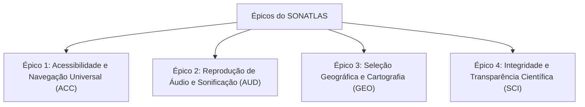

# 04. Histórias de Usuário (User Stories)

As histórias de usuário do SONATLAS traduzem os requisitos do sistema em entregas incrementais de valor orientadas às personas. Estão organizadas por quatro épicos principais, com identificação padronizada, prioridade e critérios de aceitação rigorosamente testáveis.

---

## Estrutura dos Épicos

---

## Épico 1: Acessibilidade e Navegação Universal (ACC)

### US-ACC-01: Navegação Plena por Teclado
- **Como** pessoa com deficiência motora ou visual que depende exclusivamente do teclado,
- **Quero** navegar por todos os elementos interativos na ordem lógica da página,
- **Para que** eu possa operar todas as funcionalidades sem a necessidade de um mouse.
- **Requisitos Vinculados:** RF03, RF07, RNF02.
- **Prioridade:** **Alta** (Must Have).
- **Critérios de Aceite:**
  1. O foco visual (`focus-visible`) deve apresentar anel nítido de largura mínima de 2px e contraste >= 3:1 em todos os botões e seletores.
  2. A tecla `Tab` move o foco na sequência: *Skip-link* &rarr; Cabeçalho &rarr; Seletor de Região &rarr; Controles do Player &rarr; Linha do Tempo &rarr; Legenda Sonora.
  3. A tecla `Shift + Tab` retrocede o foco na ordem inversa sem bloqueios (*keyboard traps*).
  4. Teclas de atalho globais: `Espaço` alterna Play/Pause, `Setas` avançam/retrocedem observações e `M` ativa/desativa o áudio.

### US-ACC-02: Comunicação de Estados via Leitor de Tela
- **Como** pessoa cega que utiliza leitor de tela (NVDA/JAWS/VoiceOver),
- **Quero** receber anúncios audíveis e estruturados sempre que o passo temporal mudar ou uma ação for concluída,
- **Para que** eu acompanhe o estado da observação em tempo real.
- **Requisitos Vinculados:** RF11, RNF01.
- **Prioridade:** **Alta** (Must Have).
- **Critérios de Aceite:**
  1. As mensagens são publicadas em uma região com atributo `aria-live="polite"` e `aria-atomic="true"`.
  2. O anúncio inclui: número do passo, total de passos, data/hora formatada, taxa média em mm/h e cobertura percentual.
  3. O leitor não deve emitir anúncios repetitivos se o estado permanecer inalterado.
  4. Botões de ação possuem rótulos explícitos via `aria-label` (ex: "Avançar para a próxima observação temporal").

### US-ACC-03: Alternativa Textual para Mapas e Gráficos
- **Como** usuário com baixa visão ou cegueira,
- **Quero** acessar uma descrição textual rica e detalhada dos dados da observação,
- **Para que** minha compreensão dos fenômenos meteorológicos não dependa do mapa visual.
- **Requisitos Vinculados:** RF08, RF09, RNF01.
- **Prioridade:** **Alta** (Must Have).
- **Critérios de Aceite:**
  1. Abaixo do mapa existe um cartão de resumo textual com métricas em formato legível e rótulos de intensidade em linguagem natural.
  2. Os elementos visuais do mapa Leaflet possuem `aria-hidden="true"` para evitar poluição do fluxo do leitor de tela.

---

## Épico 2: Reprodução de Áudio e Sonificação (AUD)

### US-AUD-01: Controle do Jukebox Sonoro
- **Como** usuário explorador do SONATLAS,
- **Quero** iniciar, pausar, avançar passo a passo e silenciar a sonificação da série temporal,
- **Para que** eu possa escutar a dinâmica dos dados no meu próprio ritmo de absorção cognitiva.
- **Requisitos Vinculados:** RF03, RF07, RNF04.
- **Prioridade:** **Alta** (Must Have).
- **Critérios de Aceite:**
  1. O botão Play/Pause alterna instantaneamente o estado de reprodução em menos de 50 milissegundos.
  2. Ao pausar, a síntese de áudio é cessada imediatamente sem ruídos ou cortes abruptos.
  3. Botões de avanço e retrocesso permitem inspecionar instantes específicos da série com emissão do respectivo som.
  4. Botão Mute silencia o áudio sem interromper o avanço visual da linha do tempo.

### US-AUD-02: Mapeamento Perceptivo de Intensidade e Extensão
- **Como** ouvinte da sonificação científica,
- **Quero** que a intensidade da chuva seja comunicada pela frequência do som e a área de abrangência pela densidade dos pulsos,
- **Para que** eu consiga diferenciar intuitivamente uma chuva fraca localizada de uma tempestade severa generalizada.
- **Requisitos Vinculados:** RF04, RNF05, RN02.
- **Prioridade:** **Alta** (Must Have).
- **Critérios de Aceite:**
  1. Taxa média de precipitação mais alta produz frequências fundamentais mais agudas (faixa confortável de 220 Hz a 880 Hz).
  2. Maior proporção de área chuvosa resulta em maior número de repetições de pulso dentro do ciclo de 1.5 segundos (de 1 a 7 pulsos).
  3. Taxas insignificantes (< 0.1 mm/h) geram tom suave de repouso (130 Hz) ou silêncio.
  4. A envoltória acústica (ADSR) possui tempos de subida (*attack*) e descida (*release*) suaves para prevenir estalos (*clicks*).

### US-AUD-03: Legenda Sonora Interativa de Calibração
- **Como** usuário iniciante na plataforma,
- **Quero** ouvir amostras de referência individuais antes de reproduzir a série temporal,
- **Para que** meu cérebro aprenda a calibrar o significado dos tons e ritmos com os conceitos meteorológicos.
- **Requisitos Vinculados:** RF06.
- **Prioridade:** **Alta** (Must Have).
- **Critérios de Aceite:**
  1. Disponibilização de pelo menos três botões de amostra: "Chuva Leve / Localizada", "Chuva Moderada" e "Tempestade Severa".
  2. Disponibilização de um botão de amostra para o "Sinal de Dado Ausente".
  3. Cada botão reproduz uma amostra curta acompanhada de descrição textual de apoio.

---

## Épico 3: Seleção Geográfica e Cartografia (GEO)

### US-GEO-01: Seleção de Regiões de Estudo
- **Como** estudante ou pesquisador,
- **Quero** alternar entre a Amazônia Central e a região internacional candidata,
- **Para que** eu possa comparar diferentes regimes pluviométricos tropicais.
- **Requisitos Vinculados:** RF01, RF02, RN06.
- **Prioridade:** **Alta** (Must Have).
- **Critérios de Aceite:**
  1. Seletor acessível via `<select>` com rótulo explícito e texto de apoio.
  2. A alteração de região recarrega a respectiva série temporal em JSON e atualiza o mapa.
  3. A região internacional candidata exibe aviso explícito: *"Área candidata sob validação científica"*.

### US-GEO-02: Visualização de Delimitação Territorial em Mapa 2D
- **Como** usuário com visão funcional,
- **Quero** ver o contorno da área amostrada desenhado sobre um mapa base 2D,
- **Para que** eu compreenda a localização espacial e a escala territorial da coleta.
- **Requisitos Vinculados:** RF10, RNF06.
- **Prioridade:** **Média** (Should Have).
- **Critérios de Aceite:**
  1. Mapa 2D renderizado via Leaflet com camada base contrastante.
  2. Polígono GeoJSON azul translúcido destacando os limites da *bounding box*.
  3. O mapa não sequestra a rolagem do teclado (*scroll wheel* desabilitado por padrão).

---

## Épico 4: Integridade e Transparência Científica (SCI)

### US-SCI-01: Transparência Metodológica e Unidades
- **Como** educador ou pesquisador,
- **Quero** visualizar explicitamente as unidades físicas (`mm/h`) e a fonte de satélite,
- **Para que** o conteúdo tenha validade pedagógica e confiabilidade científica.
- **Requisitos Vinculados:** RF08, RN02, RN05.
- **Prioridade:** **Alta** (Must Have).
- **Critérios de Aceite:**
  1. Todas as menções à intensidade utilizam a unidade estrita `mm/h`.
  2. Indicação explícita da fonte candidata: *"NASA GPM / IMERG V07 via GES DISC"*.
  3. Todo quadro visual do EIC exibe o status `"pending_official_validation"`.

### US-SCI-02: Tratamento e Identificação de Dados Ausentes
- **Como** analista de dados,
- **Quero** que passos temporais sem dados válidos sejam destacados visualmente e acusticamente,
- **Para que** falhas instrumentais não sejam interpretadas como estiagem ou calmaria.
- **Requisitos Vinculados:** RF05, RN01, RN04.
- **Prioridade:** **Alta** (Must Have).
- **Critérios de Aceite:**
  1. Passos temporais sem dados exibem a mensagem textual *"Dados não disponíveis"* e valor `null` no JSON (nunca `0.0 mm/h`).
  2. A sonificação emite tom específico de advertência não-musical.
  3. Dados demonstrativos contêm metadado `"is_sample": true`.
