# 05. Metodologia, Planejamento e Gestão do Projeto

Este documento formaliza a metodologia ágil de gestão do SONATLAS, a delimitação rigorosa do MVP, o modelo de governança no **GitHub Projects** e o catálogo detalhado de tarefas técnicas (TEC) distribuídas entre os cinco desenvolvedores da equipe.

---

## 1. Contexto do NASA Space Apps Challenge 2026

O **NASA Space Apps Challenge** é a maior maratona global de inovação aberta e ciência cidadã do planeta. Organizado anualmente pela NASA em parceria com agências espaciais internacionais, o evento reúne equipes multidisciplinares para resolver desafios reais utilizando dados públicos de missões de observação da Terra.

### O Desafio Escolhido: *The Earth Information Jukebox*
- **Objetivo do Desafio:** Criar experiências auditivas e multissensoriais dinâmicas que transformem conjuntos de dados e visualizações da Terra em composições informativas e cativantes.
- **Foco do SONATLAS:** Desenvolver uma plataforma web acessível que converta dados de precipitação da missão **NASA GPM IMERG** em experiências sonoras paramétricas e visuais, priorizando pessoas cegas ou com baixa visão.

---

## 2. Definição Rigorosa do Escopo do MVP

O Produto Mínimo Viável (MVP) prioriza uma experiência **funcional, cientificamente íntegra e 100% acessível**.

```mermaid
graph TD
    MVP["Escopo do MVP — SONATLAS"]
    MVP --> IN["O que ESTÁ no MVP (Entregas Obrigatórias)"]
    MVP --> OUT["O que NÃO ESTÁ no MVP (Limites de Escopo)"]

    IN --> IN1["Região Nacional: Amazônia Central com GeoJSON documentado"]
    IN --> IN2["Série de precipitação NASA GPM IMERG V07 associada"]
    IN --> IN3["Visualização cartográfica 2D Leaflet com fallback textual"]
    IN --> IN4["Indicadores: Taxa média (mm/h), Cobertura (%) e Variação"]
    IN --> IN5["Linha do tempo interativa e seleção de passos"]
    IN --> IN6["Síntese sonora em tempo real via Web Audio API"]
    IN --> IN7["Player com controles: Play, Pause, Avançar, Voltar, Mute"]
    IN --> IN8["Legenda sonora interativa para calibração auditiva"]
    IN --> IN9["Audiodescrição estruturada em linguagem natural"]
    IN --> IN10["Navegação 100% por teclado e região aria-live para leitores"]
    IN --> IN11["Tratamento explícito de dados ausentes (sem imputar zero)"]
    IN --> IN12["Globo 3D opcional com alternativa 2D Leaflet"]

    OUT --> OUT2["Inteligência artificial generativa"]
    OUT --> OUT3["Autenticação e cadastro de usuários"]
    OUT --> OUT4["Banco de dados permanente (SQL/NoSQL)"]
    OUT --> OUT5["Múltiplos fenômenos terrestres simultâneos"]
    OUT --> OUT6["Seleção arbitrária de coordenadas no mapa"]
    OUT --> OUT7["Composição musical orquestral complexa"]
```

> **Diretriz para a Segunda Região:** A **Bacia do Congo** é tratada como expansão planejada sujeita à validação científica de período, fontes e grânulos. A comparação entre regiões não é tratada como funcionalidade garantida até que a compatibilidade dos dados seja formalmente homologada.

---

## 3. Configuração do GitHub Projects

O gerenciamento do ciclo de vida das tarefas e histórias é centralizado no projeto:

**Nome do Projeto:** `SONATLAS | Desenvolvimento e Gestão do Produto`

### 3.1. Quadro Kanban e Colunas
1. **Backlog:** Todas as histórias e tarefas técnicas mapeadas, aguardando início de ciclo.
2. **A Fazer (*To Do*):** Itens priorizados para a Sprint corrente.
3. **Em Andamento (*In Progress*):** Itens em desenvolvimento ativo por um membro da equipe.
4. **Em Revisão (*In Review / PR*):** Funcionalidades com Pull Request aberto aguardando aprovação de revisor e CI.
5. **Concluído (*Done*):** Código integrado à branch `main` e validado nos testes.

### 3.2. Campos Personalizados (*Custom Fields*)
- **Tipo:** `Épico`, `História de Usuário`, `Tarefa Técnica`, `Bug`, `Documentação`.
- **Prioridade:** `Crítica`, `Alta`, `Média`, `Baixa`.
- **Responsável:** Atribuição formal a um dos 5 desenvolvedores (Dev 1 a Dev 5).
- **Sprint / Etapa:** `Sprint 0 (Fundação)`, `Sprint 1 (Módulos Nucleares)`, `Sprint 2 (Acessibilidade & UX)`, `Sprint 3 (Validação & Homologação)`.
- **Status:** Coluna ativa no Kanban.
- **Módulo do Sistema:** `Frontend`, `Geoprocessamento`, `Dados Científicos`, `Áudio/Sonificação`, `Acessibilidade`, `Infraestrutura/CI`, `Documentação`.

---

## 4. Cronograma de Sprints

| Sprint | Foco Temático | Entregas Principais |
|---|---|---|
| **Sprint 0** | **Fundação e Governança** | Repositório estruturado, portal MkDocs publicado no GitHub Pages, workflow de CI e dicionário JSON formal. |
| **Sprint 1** | **Módulos Centrais do MVP** | Síntese de áudio paramétrica Web Audio API, carregamento do dataset da Amazônia Central, mapa Leaflet e pipeline Python. |
| **Sprint 2** | **Acessibilidade Universal & UX** | Conformidade WCAG 2.1 AA/AAA, região `aria-live`, testes de tela desligada, atalhos de teclado e legenda sonora. |
| **Sprint 3** | **Validação Científica & Pitch** | Ingestão de grânulos brutos IMERG GES DISC, testes de percepção com usuários e validação da região internacional. |

---

## 5. Catálogo de Tarefas Técnicas (TEC01 a TEC24)

As tarefas técnicas decompõem a arquitetura em itens acionáveis de engenharia:

### Módulo: Frontend Core
- **TEC01 — Setup do Frontend React + Vite + TypeScript:** Inicialização da aplicação com tipagem estrita, configurações de linting e scripts de build. *(Dev 1 | Alta | Concluído)*
- **TEC02 — Implementação do Design System e CSS Acessível:** Criação de variáveis de cores de alto contraste (`variables.css`), reset semântico, estilos de botões, cartões e skip-link. *(Dev 1 | Alta | Concluído)*
- **TEC03 — Desenvolvimento do Jukebox Player:** Criação do componente `AudioPlayer.tsx` com botões Play, Pause, Avançar, Retroceder, Mute e badges de status. *(Dev 1 | Crítica | Concluído)*
- **TEC04 — Linha do Tempo Interativa:** Desenvolvimento do componente `Timeline.tsx` com renderização dos passos temporais e indicação de passo ativo (`aria-current="step"`). *(Dev 1 | Alta | Concluído)*
- **TEC05 — Painel de Indicadores Científicos:** Componente `ScientificSummary.tsx` exibindo taxa média em `mm/h`, porcentagem de cobertura, pico pontual e audiodescrição textual. *(Dev 1 | Alta | Concluído)*
- **TEC06 — Seletor de Regiões:** Componente `RegionSelector.tsx` acessível via `<select>` com rótulos e avisos de status de validação. *(Dev 1 | Alta | Concluído)*

### Módulo: Geoprocessamento e Cartografia
- **TEC07 — Criação do GeoJSON da Amazônia Central:** Estruturação da *bounding box* da bacia de referência em `processing/geometry/amazon/central_amazon_bbox.geojson`. *(Dev 2 | Alta | Concluído)*
- **TEC08 — Estruturação do Placeholder da Região Internacional:** Criação de orientações e arquivo placeholder para a Bacia do Congo em `processing/geometry/international/`. *(Dev 2 | Média | Concluído)*
- **TEC09 — Integração do Mapa 2D Leaflet:** Componente `MapView.tsx` para renderizar polígonos GeoJSON sobre camada base com atributo `aria-hidden="true"`. *(Dev 2 | Alta | Concluído)*
- **TEC10 — Alternativa Textual para Mapas:** Implementação de fallback acessível com descrição de coordenadas geográficas mínimas e máximas. *(Dev 2 | Alta | Concluído)*

### Módulo: Dados Científicos e Pipeline Python
- **TEC11 — Implementação do Módulo de Extração GPM:** Classe `GPMExtractor` em `processing/extraction/gpm_extractor.py` para recorte espacial de matrizes de grade. *(Dev 4 | Alta | Concluído)*
- **TEC12 — Algoritmo de Ponderação Cosseno da Latitude:** Função `calculate_mean_precipitation_rate` aplicando peso $\cos(\phi)$ nas células válidas. *(Dev 4 | Crítica | Concluído)*
- **TEC13 — Cálculo da Fração de Área com Chuva (RAF):** Implementação de filtro com limiar de detecção $R \ge 0.1 \text{ mm/h}$. *(Dev 4 | Crítica | Concluído)*
- **TEC14 — Validador de Integridade e Regras Científicas:** Módulo `DataValidator` que rejeita dados com unidades incorretas e proíbe imputação de zero para nulos. *(Dev 4 | Crítica | Concluído)*
- **TEC15 — Script de Exportação JSON:** CLI `run_pipeline.py` para gerar datasets formatados em conformidade com o `data-dictionary.md`. *(Dev 4 | Alta | Concluído)*

### Módulo: Motor de Áudio e Sonificação
- **TEC16 — Síntese Nativa com Web Audio API:** Classe `AudioEngine.ts` com gerenciamento de `AudioContext`, nós de oscilador e nós de ganho. *(Dev 3 | Crítica | Concluído)*
- **TEC17 — Mapeamento Psicoacústico de Frequência e Ritmo:** Módulo `sonificationMapping.ts` convertendo mm/h em frequência (220 Hz a 880 Hz) e área em pulsos (1 a 7). *(Dev 3 | Crítica | Concluído)*
- **TEC18 — Programação da Envoltória ADSR:** Modelagem de ataques e decaimentos suaves de ganho para eliminar estalos e ruídos de fase nos pulsos. *(Dev 3 | Alta | Concluído)*
- **TEC19 — Sinal Sonoro de Advertência para Dados Ausentes:** Síntese de tom em onda triangular dissonante disparado quando a observação for nula. *(Dev 3 | Crítica | Concluído)*
- **TEC20 — Componente de Legenda Sonora Interativa:** Desenvolvimento do `SoundLegend.tsx` com botões de calibração auditiva para os três regimes de chuva. *(Dev 3 | Alta | Concluído)*

### Módulo: Acessibilidade Digital e UX
- **TEC21 — Provedor de Anúncios Dinâmicos via Leitor de Tela:** Componente `AriaLiveAnnouncer.tsx` com `aria-live="polite"` centralizado. *(Dev 5 | Crítica | Concluído)*
- **TEC22 — Gerenciador de Atalhos Globais de Teclado:** Hook `useKeyboardShortcuts.ts` mapeando `Espaço`, `Setas` e `M`, acompanhado de modal explicativo. *(Dev 5 | Alta | Concluído)*

### Módulo: Infraestrutura, CI/CD e Documentação
- **TEC23 — Pipeline de Integração Contínua (CI):** Workflow `.github/workflows/ci.yml` testando build do frontend, TypeScript, testes Python e MkDocs strict. *(Dev 5 | Alta | Concluído)*
- **TEC24 — Deploy Automatizado da Documentação (GitHub Pages):** Workflow `.github/workflows/deploy-docs.yml` compilando e publicando o portal MkDocs no GitHub Pages. *(Dev 5 | Alta | Concluído)*

---

## 6. Rituais e Governança da Equipe

1. **Revisões Assíncronas de PR:** Todo Pull Request deve ser vinculado a uma História (US) ou Tarefa Técnica (TEC) e preencher os checklists de acessibilidade e ciência.
2. **Critério de Aceite da Sprint (Definition of Done):**
   - 100% de compilação sem advertências TypeScript (`tsc --noEmit`).
   - Todos os testes unitários passando (`npm run test` e `pytest`).
   - Build do portal MkDocs sem links quebrados (`mkdocs build --strict`).
   - Teste prático de navegação exclusiva por teclado realizado com sucesso.
