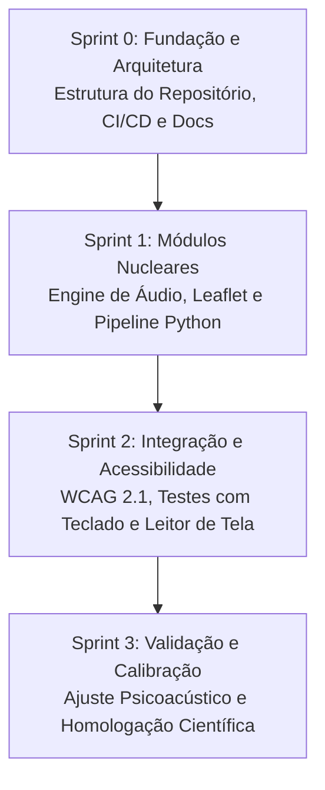
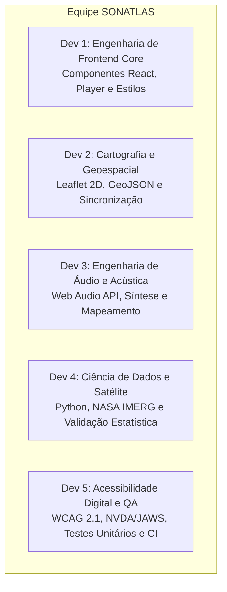

# 05. Metodologia e Planejamento

## 1. Contexto do NASA Space Apps Challenge 2026

O **NASA Space Apps Challenge** é o maior hackathon global de inovação aberta e ciência cidadã do mundo, organizado anualmente pela NASA em colaboração com agências espaciais parceiras. Durante a maratona de desenvolvimento, equipes multidisciplinares utilizam conjuntos de dados abertos (*Open Data*) de missões de observação da Terra para propor soluções a problemas prementes do planeta.

### O Desafio: The Earth Information Jukebox
O desafio **The Earth Information Jukebox** propõe a criação de experiências auditivas e multissensoriais que traduzam dados de observação da Terra (Earth Science) em representações sonoras envolventes e informativas, promovendo a popularização da ciência e ampliando o acesso de pessoas tradicionalmente excluídas das mídias visuais.

---

## 2. Abordagem de Desenvolvimento Ágil

O projeto adota uma adaptação do framework **Scrum/Kanban** customizada para o ciclo intensivo de entrega do hackathon e continuidade em residência tecnológica:

---

## 3. Etapas do Projeto e Cronograma de Sprints

| Etapa / Sprint | Foco Principal | Entregáveis Chave | Status Atual |
|---|---|---|---|
| **Sprint 0: Fundação & Governança** | Configuração do repositório, portal MkDocs, CI/CD, contratos de dados JSON. | - Repositório padronizado com Git Flow. - Portal de documentação oficial publicado. - Schema formal do `data-dictionary.md`. | Concluído |
| **Sprint 1: Módulos Centrais** | Implementação do frontend React, motor Web Audio API e scripts Python. | - Síntese de áudio paramétrica em tempo real. - Mapa Leaflet com bounding box GeoJSON. - Pipeline Python com cálculo de indicadores. | Em Execução |
| **Sprint 2: Acessibilidade & UX** | Conformidade WCAG 2.1 AA/AAA, legendas sonoras e suporte a leitores de tela. | - Canal `aria-live` funcional e polido. - Navegação completa e testada por teclado. - Audiodescrição estruturada dos indicadores. | Planejado |
| **Sprint 3: Homologação Científica** | Calibração acústica com dados reais IMERG e validação com comunidade. | - Ingestão de dados brutos IMERG V07 da GES DISC. - Calibração fina de frequências tonais. - Validação da segunda região internacional. | Planejado |

---

## 4. Divisão de Responsabilidades da Equipe (5 Integrantes)

Para assegurar eficiência e prevenir gargalos, o time foi estruturado em papéis de liderança técnica com domínios bem delimitados:

### Matriz de Responsabilidades (RACI Simplificado)

| Módulo do Repositório | Dev 1 (Front) | Dev 2 (Geo) | Dev 3 (Áudio) | Dev 4 (Dados) | Dev 5 (Acess/QA) |
|---|:---:|:---:|:---:|:---:|:---:|
| `frontend/src/components` | **R / A** | C | C | I | C |
| `frontend/src/maps` | C | **R / A** | I | C | C |
| `frontend/src/audio` | C | I | **R / A** | C | C |
| `processing/` (Python) | I | C | C | **R / A** | C |
| `frontend/src/accessibility` | C | C | C | I | **R / A** |
| `docs/` e Portal MkDocs | C | C | C | C | **R / A** |

*Legenda: **R** = Responsável pela Execução, **A** = Aprovador/Líder, **C** = Consultado, **I** = Informado.*

---

## 5. Rituais e Práticas de Engenharia

1. **Revisões Diárias Assíncronas (Daily Check-in):** Compartilhamento de impedimentos e progresso via canal da equipe no Discord/GitHub.
2. **Revisão de Código Obrigatória (Peer Review):** Todo Pull Request deve ser revisado por pelo menos um colega especialista antes do merge na branch `main`.
3. **Automação de Qualidade (CI):** A cada push na branch principal ou em PRs, a esteira do GitHub Actions valida a compilação TypeScript, suíte de testes unitários e build da documentação.
