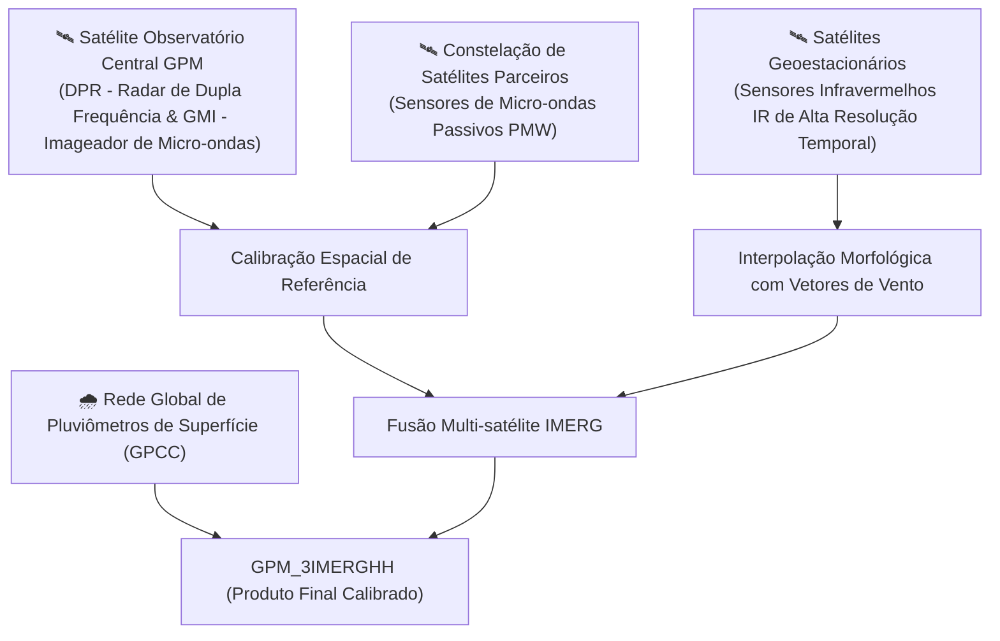

# 06. Dados Científicos e Metodologia

Este documento estabelece o embasamento físico, geofísico e matemático dos dados utilizados pelo SONATLAS, assegurando que todas as transformações de dados em som respeitem princípios científicos invioláveis.

---

## 1. Fonte de Dados Candidata: NASA GPM / IMERG V07

O projeto adota como base científica os produtos da missão **Global Precipitation Measurement (GPM)**, especificamente o algoritmo **IMERG (Integrated Multi-satellitE Retrievals for GPM)**, versão 07.

### Especificações do Produto
- **Código Oficial do Produto:** `GPM_3IMERGHHE` (Early Run para latência rápida) e `GPM_3IMERGHH` (Final Run para pesquisa com calibração em pluviômetros).
- **Centro Distribuidor:** NASA Goddard Earth Sciences Data and Information Services Center (GES DISC).
- **Resolução Espacial:** Grade regular global de $0.1^\circ \times 0.1^\circ$ (aproximadamente $11 \text{ km} \times 11 \text{ km}$ no equador).
- **Resolução Temporal:** Passo de 30 minutos (*half-hourly*).
- **Variável Física Extraída:** `precipitationCal` (taxa de precipitação calibrada por múltiplos sensores).

---

## 2. Diferenciação Física Crucial: Taxa ($\text{mm/h}$) vs. Acumulação ($\text{mm}$)

> :octicons-alert-16: **REGRA CIENTÍFICA ABSOLUTA:**  
> A taxa de precipitação instantânea ($\text{mm/h}$) e a precipitação acumulada ($\text{mm}$) são grandezas físicas distintas e jamais devem ser confundidas ou somadas diretamente.

1. **Taxa Instantânea de Precipitação ($\text{mm/h}$):** Mede a intensidade com que a água está caindo no instante da observação ($R$). É análoga à velocidade de um veículo em $\text{km/h}$.
2. **Precipitação Acumulada ($\text{mm}$):** Representa o volume total de água por unidade de área precipitado ao longo de um intervalo de tempo contínuo ($\Delta t$):
   $$\text{Acumulação } (P) = \int_{t_0}^{t_1} R(t) \, dt$$
   Para um grânulo do IMERG de 30 minutos ($\Delta t = 0.5 \text{ h}$) sob taxa constante $R$, a acumulação equivale a $R \times 0.5 \text{ mm}$.

**No SONATLAS:**
O motor de sonificação traduz primordialmente a **taxa de precipitação instantânea ($\text{mm/h}$)** nos parâmetros acústicos em tempo real. Qualquer agregação cumulativa deve declarar expressamente a unidade $\text{mm}$ e a janela de tempo de acumulação.

---

## 3. Delimitação das Regiões de Estudo

### 3.1. Região Nacional: Amazônia Central (Brasil)
- **Status:** Verificada Preliminarmente
- **Coordenadas de Referência (WGS84):**
  - Latitude: $-4.0^\circ$ a $-1.5^\circ$ Sul
  - Longitude: $-61.5^\circ$ a $-58.5^\circ$ Oeste
- **Justificativa Bioclimática:** Região de encontro dos Rios Negro e Solimões/Amazonas, próxima à Reserva Florestal Cuieiras (ZF2) e à Torre ATTO (*Amazon Tall Tower Observatory*). Apresenta um dos ciclos hidrológicos mais vigorosos e dinâmicos do planeta.

### 3.2. Região Internacional: Área de Estudo Candidata
- **Status:** Candidata Preliminar Sob Validação
- **Região Candidata em Estudo:** Bacia do Congo (África Central).
- **Diretriz de Integridade Científica:** A escolha definitiva da segunda região ainda aguarda validação formal da equipe de mentores. Em estrito respeito às boas práticas científicas, **nenhuma coordenada arbitrária ou dado fictício foi associado à região**; o repositório mantém apenas arquivos de orientação estrutural (*placeholders*) até a homologação dos dados reais.

---

## 4. Indicadores Científicos Calculados no Pipeline

### 4.1. Taxa Média com Ponderação Cosseno da Latitude
Como a área real das células de uma grade regular $(\Delta \phi \times \Delta \lambda)$ decresce com o cosseno da latitude ($\phi$), o cálculo da média espacial sobre as células válidas na *bounding box* aplica a seguinte fórmula:

$$\bar{R} = \frac{\sum_{i=1}^{N} R_i \cdot w_i \cdot \cos(\phi_i)}{\sum_{i=1}^{N} w_i \cdot \cos(\phi_i)}$$

onde:
- $R_i$ é a taxa de precipitação na célula $i$ ($\text{mm/h}$).
- $\phi_i$ é a latitude do ponto central da célula em radianos.
- $w_i \in \{0, 1\}$ é a máscara de validade ($w_i = 1$ se o dado for válido e estiver contido na geometria; $w_i = 0$ se for ausente ou externo).

### 4.2. Fração de Área com Chuva Positiva ($\text{Rain Area Fraction}$)
Permite discernir eventos de convecção isolada de tempestades amplas e generalizadas:

$$\text{RAF} = \frac{\sum_{i \in \text{Válidos}} \mathbb{I}(R_i \ge 0.1 \text{ mm/h}) \cdot \cos(\phi_i)}{\sum_{i \in \text{Válidos}} \cos(\phi_i)}$$

O limiar de $0.1 \text{ mm/h}$ corresponde ao limite inferior confiável de detecção dos radiômetros de micro-ondas da constelação GPM.

### 4.3. Variabilidade Temporal ($\Delta R$)
Expressa o aumento ou dissipação da chuva em relação ao passo imediatamente anterior:

$$\Delta R_k = \bar{R}(t_k) - \bar{R}(t_{k-1})$$

---

## 5. Tratamento Ético de Dados Ausentes (*Missing Data*)

> :octicons-x-circle-16: **REGRA CIENTÍFICA ABSOLUTA:**  
> Células com falha instrumental ou sem retorno de satélite NUNCA devem ser tratadas como precipitação zero.

No IMERG, dados não mensuráveis recebem valores sentinela (ex: $-9999.9$). O pipeline do SONATLAS:
1. Converte valores sentinela imediatamente em `NaN` (`numpy.nan`).
2. Calcula a **Razão de Validade** ($N_{\text{válidos}} / N_{\text{total}}$).
3. Se a razão for inferior a $10\%$, o passo é classificado como `"missing"` e o indicador de taxa recebe `null` no JSON.
4. Na interface, exibe-se a mensagem explícita de indisponibilidade e o motor de áudio emite um tom de alerta característico, evitando falsas interpretações de calmaria ou estiagem.

---

## 6. Relação com as Visualizações do Earth Information Center (EIC)

> :octicons-info-16: **AVISO DE VALIDAÇÃO PENDENTE:**  
> As animações e mapas colorimétricos divulgados pelo Earth Information Center (EIC) da NASA aplicam paletas estilizadas, interpolações contínuas e filtros de suavização que nem sempre correspondem 1:1 aos valores de grade crua. No SONATLAS, todas as referências a imagens do EIC possuem o status `"pending_official_validation"` até que a correlação exata de grânulos seja verificada. É expressamente proibido inferir valores numéricos a partir da leitura de cores visuais.
