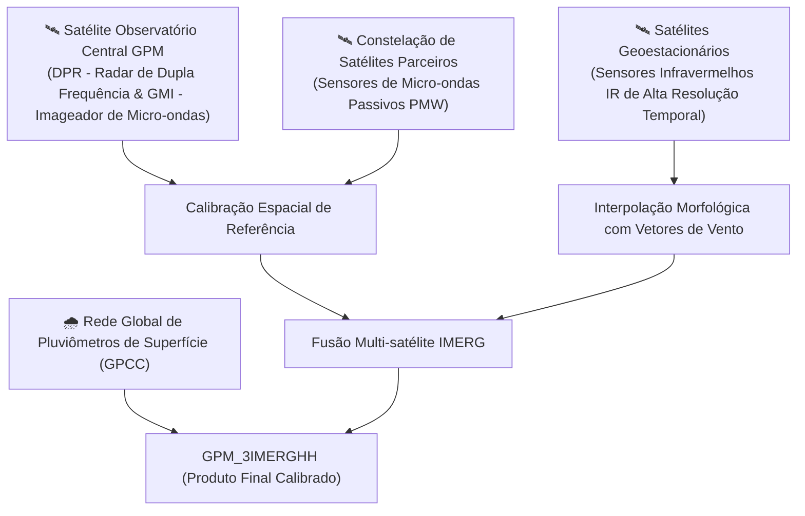

# 06. Dados Científicos e Metodologia

Este documento estabelece o embasamento físico, geofísico e matemático dos dados utilizados pelo SONATLAS, assegurando que todas as transformações de dados em som respeitem princípios científicos invioláveis.

O formato esperado para grades de precipitação por célula e sua matriz está descrito no [contrato de grade espacial](contrato-grade-espacial.md).

---

## 1. Fontes de Dados Oficiais da NASA

O projeto adota como base científica primária os produtos da missão **Global Precipitation Measurement (GPM)**, especificamente o algoritmo **IMERG (Integrated Multi-satellitE Retrievals for GPM)**, versão **07B**.



### 1.1. Referências e Diretórios Oficiais
- **NASA SVS 4285:** [https://svs.gsfc.nasa.gov/4285/](https://svs.gsfc.nasa.gov/4285/)  
  *Nota metodológica:* A animação do Scientific Visualization Studio (SVS 4285) é uma referência visual e de divulgação científica. Os indicadores e a sonificação do SONATLAS **são calculados estritamente a partir dos dados numéricos matriciais do IMERG**, e não estimados pelas cores da animação.
- **NASA GPM IMERG:** [https://gpm.nasa.gov/data/imerg](https://gpm.nasa.gov/data/imerg)
- **NASA GPM Data Directory:** [https://gpm.nasa.gov/data/directory](https://gpm.nasa.gov/data/directory)
- **Repositório GES DISC:** [https://gpm1.gesdisc.eosdis.nasa.gov/data/GPM_L3/GPM_3IMERGHH.07/](https://gpm1.gesdisc.eosdis.nasa.gov/data/GPM_L3/GPM_3IMERGHH.07/)

### 1.2. Especificações do Produto IMERG V07B
- **Produto Primário do Pipeline:** **`NASA GPM IMERG Early Run V07B — GPM_3IMERGHHE.07B`** (Half-Hourly, latência de ~4 horas). O pipeline também suporta a transição para o produto `GPM_3IMERGHH` (Final Run, com calibração pós-evento por pluviômetros do GPCC). São execuções distintas; não atribua ao dataset Early as características de calibração do Final.
- **Formato Nativo:** HDF5 estruturado sob o grupo `/Grid` (ou NetCDF-4 `.nc4`).
- **Resolução Espacial:** Grade regular global de $0.1^\circ \times 0.1^\circ$ (aproximadamente $11 \text{ km} \times 11 \text{ km}$ no equador).
- **Resolução Temporal:** Passo de 30 minutos (*half-hourly*).

### 1.3. Estado do dataset publicado
O dataset Early V07B está publicado em `frontend/public/data/amazon/observations.json`. Sua validação estrutural foi concluída; a validação científica permanece preliminar e a recalculação independente dos indicadores diretamente dos arquivos HDF5 ainda está pendente. A publicação e a validação estrutural não equivalem à validação científica final. O produto Early é uma estimativa de baixa latência (~4 h) e pode ser revisado; o produto Final tem latência maior e incorpora calibração de pluviômetros. Não trate a série Early como equivalente ao produto Final.

---

## 2. Investigação Técnica da Variável de Precipitação

### 2.1. `/Grid/precipitationCal` vs `/Grid/precipitation`
Na documentação oficial da versão **IMERG V07B**:
- **Variável Principal:** `/Grid/precipitationCal`  
  - **Definição:** Estimativa de taxa de precipitação derivada de observações multissatélite. O ajuste por pluviômetros depende da execução do produto; o Early V07B publicado no SONATLAS não deve ser descrito como o produto Final calibrado.
  - **Unidade de Medida:** **`mm/hr`** (milímetros por hora &mdash; taxa instantânea).
  - **Valor Sentinela (`_FillValue`):** `-9999.9` (representa dados ausentes ou sem cobertura instrumental).
- **Variável Secundária (`Grid/precipitation`):** Utilizada em alguns produtos derivados diários (em mm/day) ou subsetters GeoTIFF/GIS.
- **Estratégia de Implementação no Pipeline:** O leitor verifica prioritariamente `/Grid/precipitationCal`, com fallback para `/Grid/precipitation`, validando explicitamente se o atributo `units` contém `mm/hr`.

### 2.2. Sistema de Coordenadas e Transposição Espacial
- **Latitude (`lat`):** 1800 pontos, de $-89.95^\circ$ a $+89.95^\circ$ (resolução $0.1^\circ$).
- **Longitude (`lon`):** 3600 pontos, de $-179.95^\circ$ a $+179.95^\circ$ (resolução $0.1^\circ$).
- :warning: **Peculiaridade de Indexação do HDF5:**  
  No arquivo HDF5 nativo da NASA, a matriz de precipitação está armazenada como `(lon, lat)` com dimensões `(3600, 1800)`. Para manipulação em bibliotecas geoespaciais e exibição cartográfica, o extrator aplica a **transposição (`.T`)** para obter `(lat, lon)` com dimensões `(1800, 3600)`.

---

## 3. Diferenciação Física Crucial: Taxa ($\text{mm/h}$) vs. Acumulação ($\text{mm}$)

> :octicons-alert-16: **REGRA CIENTÍFICA ABSOLUTA:**  
> A taxa de precipitação instantânea ($\text{mm/h}$) e a precipitação acumulada ($\text{mm}$) são grandezas físicas distintas e jamais devem ser confundidas ou somadas diretamente.

1. **Taxa Instantânea de Precipitação ($\text{mm/h}$):** Mede a intensidade com que a água está caindo no instante da observação ($R$). É análoga à velocidade de um veículo em $\text{km/h}$.
2. **Precipitação Acumulada ($\text{mm}$):** Representa o volume total de água por unidade de área precipitado ao longo de um intervalo de tempo contínuo ($\Delta t$):
   $$\text{Acumulação } (P) = \int_{t_0}^{t_1} R(t) \, dt$$
   Para um grânulo do IMERG de 30 minutos ($\Delta t = 0.5 \text{ h}$) sob taxa constante $R$, a acumulação equivale a $R \times 0.5 \text{ mm}$.

**No SONATLAS:**
O motor de sonificação traduz primordialmente a **taxa de precipitação instantânea ($\text{mm/h}$)** nos parâmetros acústicos em tempo real. Qualquer agregação cumulativa deve declarar expressamente a unidade $\text{mm}$ e a janela de tempo de acumulação.

---

## 4. Delimitação das Regiões de Estudo

### 4.1. Região Nacional Piloto: Amazônia Central (Brasil)
- **Status:** <span class="badge-verified">Preliminarmente Verificada (preliminary_verified)</span>
- **Coordenadas de Referência (WGS84):**
  - Latitude: $-4.0^\circ$ a $-1.5^\circ$ Sul (25 células de $0.1^\circ$)
  - Longitude: $-61.5^\circ$ a $-58.5^\circ$ Oeste (30 células de $0.1^\circ$)
  - **Total de Células:** 750 células espaciais.
- **Série Temporal Real Processada:** Sequência de doze grânulos de 30 minutos em 01/01/2024 (janelas da madrugada e tarde) extraídos do produto `NASA GPM IMERG Early Run V07B — GPM_3IMERGHHE.07B`, lidos a partir de `processing/data/raw/*.HDF5`.
- **Dataset Real Oficial:** Publicado em [`frontend/public/data/amazon/observations.json`](file:///c:/Users/sarah/OneDrive/Desktop/nasa/frontend/public/data/amazon/observations.json) (espelhado em [`frontend/public/data/amazon_central_series.json`](file:///c:/Users/sarah/OneDrive/Desktop/nasa/frontend/public/data/amazon_central_series.json)), com `is_sample: false`.
- **Pipeline Científico de Processamento:** [`processing/scripts/process_amazon_real.py`](file:///c:/Users/sarah/OneDrive/Desktop/nasa/processing/scripts/process_amazon_real.py).
- **Justificativa Bioclimática:** Região de confluência dos Rios Negro e Solimões/Amazonas, próxima à Reserva ZF2 e à Torre ATTO (*Amazon Tall Tower Observatory*). Apresenta um dos regimes convectivos tropicais mais dinâmicos do planeta.

#### Diferenciação entre Dados Reais e Sintéticos
- **`processing/scripts/process_amazon_real.py`:** Pipeline oficial que realiza a abertura dos HDF5 reais via `h5py`, tratamento de sentinelas, transposição matricial, recorte e cálculo de indicadores ponderados por cosseno da latitude (`is_sample: false`).
- **`processing/scripts/run_pipeline.py --demo`:** Script de demonstração offline para gerar o arquivo sintético de bootstrap [`processing/data/samples/amazon_central_sample.json`](file:///c:/Users/sarah/OneDrive/Desktop/nasa/processing/data/samples/amazon_central_sample.json) (`is_sample: true`).
- A autenticidade científica dos dados é garantida pela rastreabilidade e proveniência dos grânulos brutos HDF5 arquivados, e não exclusivamente por flags booleanas.

### 4.2. Região Internacional Candidata: Bacia do Congo (Janela de Kisangani, RDC)
- **Status:** <span class="badge-pending">Candidata sob Revisão Técnica (candidate_under_review)</span>
- **Coordenadas de Referência (WGS84):**
  - Latitude: $-0.8^\circ$ a $+1.7^\circ$ Norte (25 células de $0.1^\circ$)
  - Longitude: $23.7^\circ$ a $26.7^\circ$ Leste (30 células de $0.1^\circ$)
  - **Total de Células:** 750 células espaciais (simetria dimensional 1:1 com a grade da Amazônia).
- **Série Temporal Real Processada:** Amostra de seis grânulos vespertinos em 01/01/2024 (17:00:00 UTC a 19:59:59 UTC) extraídos do produto `NASA GPM IMERG Early Run V07B — GPM_3IMERGHHE.07B`.
- **Dataset Real Oficial:** Publicado em [`frontend/public/data/congo/observations.json`](file:///c:/Users/sarah/OneDrive/Desktop/nasa/frontend/public/data/congo/observations.json) (e [`processing/data/processed/congo_kisangani_real_series.json`](file:///c:/Users/sarah/OneDrive/Desktop/nasa/processing/data/processed/congo_kisangani_real_series.json)), com `is_sample: false`.
- **Pipeline Científico de Processamento:** [`processing/scripts/process_congo_real.py`](file:///c:/Users/sarah/OneDrive/Desktop/nasa/processing/scripts/process_congo_real.py).
- **Contexto Bioclimático:** Janela em torno de Kisangani (República Democrática do Congo), na transição equatorial da Bacia do Congo. Na janela UTC adotada (17:00 a 19:30 UTC = 19:00 a 21:30 horário local CAT), registra a evolução da convecção noturna equatorial, atingindo pico máximo pontual de $12.70 \text{ mm/h}$ às 19:30 UTC.
- **Ressalva Metodológica de Não-Equivalência:** A janela de Kisangani constitui uma amostra de teste internacional sob avaliação e **não possui equivalência metodológica plena com a Amazônia Central**, que dispõe de cobertura temporal de 12 passos e status de verificação preliminar consolidado.

---

## 5. Indicadores Científicos Calculados no Pipeline

### 5.1. Taxa Média com Ponderação Cosseno da Latitude
Como a área real das células de uma grade regular $(\Delta \phi \times \Delta \lambda)$ decresce com o cosseno da latitude ($\phi$), o cálculo da média espacial sobre as células válidas na *bounding box* aplica a seguinte fórmula:

$$\bar{R} = \frac{\sum_{i=1}^{N} R_i \cdot w_i \cdot \cos(\phi_i)}{\sum_{i=1}^{N} w_i \cdot \cos(\phi_i)}$$

onde:
- $R_i$ é a taxa de precipitação na célula $i$ ($\text{mm/h}$).
- $\phi_i$ é a latitude do ponto central da célula em radianos.
- $w_i \in \{0, 1\}$ é a máscara de validade ($w_i = 1$ se o dado for válido e estiver contido na geometria; $w_i = 0$ se for ausente ou externo).

### 5.2. Fração de Área com Chuva Positiva ($\text{Rain Area Fraction}$)
Permite discernir eventos de convecção isolada de tempestades amplas e generalizadas:

$$\text{RAF} = \frac{\sum_{i \in \text{Válidos}} \mathbb{I}(R_i \ge 0.1 \text{ mm/h}) \cdot \cos(\phi_i)}{\sum_{i \in \text{Válidos}} \cos(\phi_i)}$$

O limiar de $0.1 \text{ mm/h}$ é o critério operacional adotado pelo SONATLAS para classificar a área com chuva e orientar o mapeamento sonoro; não deve ser apresentado como limite instrumental universal de detecção sem validação científica específica.

Na interface, esse limiar também é comunicado como **regra operacional do mapeamento sonoro**: para $0 \le R < 0.1$ mm/h, o valor observado continua sendo o valor numérico (positivo subthreshold não é zero). Esse rótulo de apresentação não altera a medição, seu arredondamento, o indicador nem o algoritmo de áudio. Zero exato, taxa positiva abaixo do limiar e valor ausente são estados distintos.

### 5.3. Variabilidade Temporal ($\Delta R$)
Expressa o aumento ou dissipação da chuva em relação ao passo imediatamente anterior:

$$\Delta R_k = \bar{R}(t_k) - \bar{R}(t_{k-1})$$

No JSON publicado, `temporal_difference` é o campo canônico para esta diferença. `temporal_variance` ainda aparece como alias legado com o mesmo valor e descrição; não representa variância estatística e não deve ser interpretado como tal sem uma decisão científica e uma unidade apropriada.

---

## 6. Tratamento Ético de Dados Ausentes (*Missing Data*)

> :octicons-x-circle-16: **REGRA CIENTÍFICA ABSOLUTA:**  
> Células com falha instrumental ou sem retorno de satélite NUNCA devem ser tratadas como precipitação zero.

No IMERG, dados não mensuráveis recebem valores sentinela (ex: $-9999.9$). O pipeline do SONATLAS:
1. Converte valores sentinela imediatamente em `NaN` (`numpy.nan`).
2. Calcula a **Razão de Validade** ($N_{\text{válidos}} / N_{\text{total}}$).
3. Se a razão for inferior a $10\%$, o passo é classificado como `"missing"` e o indicador de taxa recebe `null` no JSON.
4. Na interface, exibe-se a mensagem explícita de indisponibilidade e o motor de áudio emite um tom de alerta característico, evitando falsas interpretações de calmaria ou estiagem.

---

## 7. Como Acessar Dados Reais da NASA (Autenticação)

O acesso aos dados do GPM IMERG no NASA GES DISC é gratuito, mas requer autenticação:
1. Cadastre-se em [https://urs.earthdata.nasa.gov/](https://urs.earthdata.nasa.gov/).
2. Em *Applications* &gt; *Authorized Apps*, autorize o aplicativo **NASA GESDISC DATA ARCHIVE**.
3. Configure o arquivo `.netrc` na máquina local (`~/.netrc` no Linux/macOS ou `%USERPROFILE%\_netrc` no Windows):
   ```text
   machine urs.earthdata.nasa.gov
   login SEU_USUARIO_EARTHDATA
   password SUA_SENHA_EARTHDATA
   ```
4. Baixe os grânulos HDF5 em `processing/data/raw/` e execute o teste de inspeção:
   ```bash
   python processing/scripts/inspect_imerg.py processing/data/raw/seu_arquivo.HDF5
   ```

---

## 8. Limitações Científicas da Prova de Conceito Atual

Com o intuito de manter a mais rigorosa transparência e honestidade metodológica:

1. **Extensão Temporal:** A série matutina cobre seis observações de 30 minutos (00:00–02:59 UTC de 01/01/2024). A interface também oferece uma visão com essa janela e a vespertina (17:00–19:59 UTC), preservando a lacuna de 14h30 entre os timestamps extremos das janelas, sem interpolação. A cobertura permanece pontual e não deve ser interpretada como caracterização estatística do regime pluviométrico sazonal da Amazônia.
2. **Geometria de Delimitação:** O recorte espacial é uma *bounding box* retangular delimitada por coordenadas lat/lon WGS84, não correspondendo aos limites biológicos, hidrográficos ou políticos exatos da bacia amazônica.
3. **Produto Satelital:** Utiliza-se o algoritmo IMERG versão **Early Run V07B** (`GPM_3IMERGHHE`), que privilegia baixa latência (~4h após observação) com base em sensores de micro-ondas e infravermelho. Não se trata do produto **Final Run** (`GPM_3IMERGHH`), cuja calibração retrospectiva com dados de pluviômetros de solo (GPCC) requer meses de processamento.
