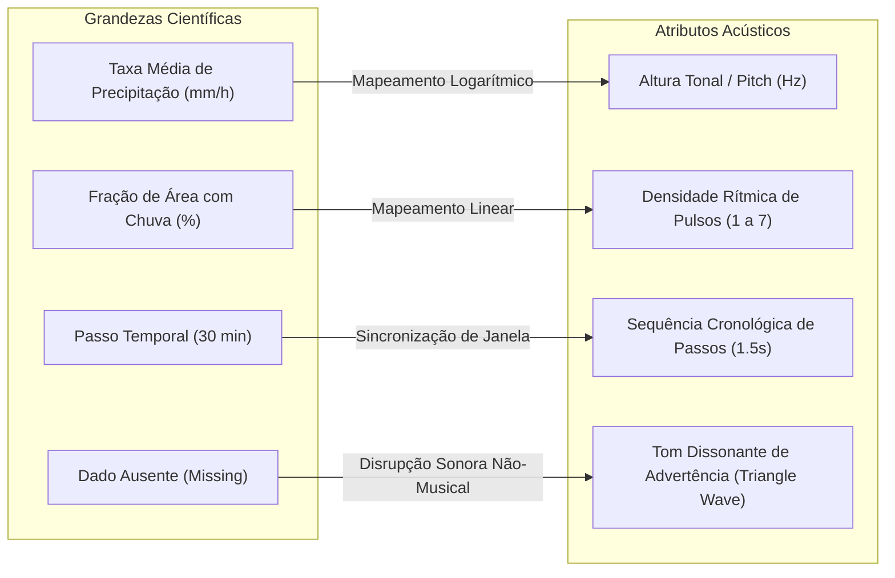

# 07. Metodologia de Sonificação Científica

A **sonificação** no SONATLAS é definida como o processo sistemático, matemático e reproduzível de converter grandezas geofísicas e espaciais da Terra em parâmetros acústicos perceptíveis pelo ouvido humano.

O objetivo central não é criar uma trilha musical ilustrativa ou decorativa, mas estabelecer uma **linguagem auditiva rigorosa** que permita discernir fenômenos climáticos com fidelidade científica.

---

## 1. Princípios Psicoacústicos Adotados

Para garantir que a audição funcione como uma ferramenta analítica eficiente, seguimos três princípios clássicos da psicoacústica e da cognição auditiva:

1. **Ortogonalidade Perceptiva:** Dimensões físicas independentes devem ser associadas a parâmetros auditivos desacoplados pelo cérebro humano (ex: a frequência tonal não deve ser confundida com a taxa de repetição de pulsos).
2. **Prevenção de Fadiga Auditiva:** A síntese concentra-se na faixa de conforto e máxima sensibilidade do sistema auditivo humano (entre 200 Hz e 1000 Hz), evitando tons ultragraves (< 80 Hz) ou estridentes (> 2000 Hz) que provocariam cansaço em usuários de leitores de tela.
3. **Calibração Psicoacústica Contínua:** As frequências e intervalos definidos nesta fase são parâmetros referenciais de engenharia, que serão calibrados empiricamente com dados reais do IMERG e testes de percepção com usuários.

---

## 2. Matriz de Mapeamento Paramétrico

| Grandeza Científica | Parâmetro Acústico | Efeito Auditivo | Justificativa Psicoacústica |
|---|---|---|---|
| **Taxa Média de Chuva ($\text{mm/h}$)** | **Frequência Fundamental ($f_0$)** | Menor taxa &rarr; som grave. Maior taxa &rarr; som agudo. | Associação intuitiva universal entre maior energia/pressão e elevação da frequência. |
| **Fração de Área com Chuva ($\text{RAF}$ %)** | **Densidade de Pulsos (Ritmo)** | Pouca área &rarr; pulsos esparsos e lentos. Área ampla &rarr; pulsos rápidos e densos. | Representação da dispersão territorial como frequência temporal de repetição. |
| **Evolução Cronológica ($t_0 \rightarrow t_k$)** | **Sequência de Segmentos (1.5s/passo)** | Cada observação dura um ciclo sonoro delimitado. | Permite que o cérebro estruture a evolução temporal como uma narrativa fluida. |
| **Taxa abaixo do limiar operacional / dado ausente** | **Repouso / alerta** | Taxa abaixo de 0.1 mm/h usa o tom de repouso; dado ausente usa dois pulsos triangulares atenuados. | Distingue a representação sonora de repouso da indisponibilidade de uma observação. |

---

## 3. Modelo Matemático de Mapeamento

### 3.1. Frequência Tonal Fundamental ($f_0$)
Para uma taxa média $R$ em $\text{mm/h}$, aplicamos uma curva logarítmica refletindo a percepção de semitons da audição humana:

$$f(R) = f_{\text{base}} + (f_{\text{teto}} - f_{\text{base}}) \cdot \frac{\log_{10}(1 + \min(R, R_{\text{max}}))}{\log_{10}(1 + R_{\text{max}})}$$

- $f_{\text{base}} = 220 \text{ Hz}$ (Nota Lá 3 / A3) para chuvas leves limiares ($0.1 \text{ mm/h}$).
- $f_{\text{teto}} = 880 \text{ Hz}$ (Nota Lá 5 / A5) para tempestades severas ($R \ge R_{\text{max}} = 50 \text{ mm/h}$).
- Para $0 \le R < 0.1 \text{ mm/h}$: o mapeamento atual aplica uma regra operacional de repouso com tom sutil em $130 \text{ Hz}$. Isso não redefine a taxa observada: uma taxa positiva abaixo do limiar continua positiva e distinta de zero; zero exato continua zero. Valor ausente é um estado separado e segue o tratamento de indisponibilidade.

O limiar de $0.1$ mm/h descrito aqui é operacional para a representação sonora. A comunicação textual preserva a taxa numérica observada e explica quando o mapeamento aplica o repouso; ela não altera os valores científicos nem o algoritmo de áudio.

### 3.2. Densidade de Pulsos ($N_{\text{pulsos}}$)
Para a proporção de área chuvosa $\text{RAF} \in [0.0, 1.0]$ dentro de um intervalo de observação de $1.5 \text{ segundos}$:

$$N_{\text{pulsos}} = \text{clamp}\Big(1 + \text{round}(6 \times \text{RAF}), \, 1, \, 7\Big)$$

- Chuva pontual ($\text{RAF} \le 15\%$): **1 pulso isolado**.
- Chuva disseminada ($\text{RAF} \approx 50\%$): **3 a 4 pulsos ritmados**.
- Tempestade generalizada em toda a bacia ($\text{RAF} \ge 85\%$): **6 a 7 pulsos densos**.

### 3.3. Envoltória Acústica ADSR
Para evitar estalos acústicos (*clicks*) no início e no fim de cada pulso, cada nota gerada no oscilador passa por um nó de ganho com envoltória programada:
- **Ataque (*Attack*):** Subida exponencial em 20 ms de 0.0001 a 0.4 de ganho.
- **Sustentação e Decaimento (*Decay/Sustain*):** Estabilidade no platô com duração proporcional ao intervalo entre pulsos.
- **Liberação (*Release*):** Queda suave exponencial para zero em 40% da duração do pulso.

---

## 4. Legenda Sonora de Calibração

Para evitar sobrecarga de interpretação, o SONATLAS disponibiliza uma **Legenda Sonora Interativa** com amostras canônicas para treinamento auditivo antes do uso da linha do tempo:

1. **Amostra 1 &mdash; Chuva Fraca e Localizada:** Frequência de 240 Hz com 1 pulso a cada 1.5s.
2. **Amostra 2 &mdash; Chuva Moderada Típica:** Frequência de 440 Hz (Lá central) com 3 pulsos ritmados em 1.5s.
3. **Amostra 3 &mdash; Tempestade Severa Generalizada:** Frequência de 750 Hz com 6 pulsos rápidos e contínuos.
4. **Amostra 4 &mdash; Advertência de Dado Ausente:** Sinal em onda triangular modulada indicando interrupção de satélite.

---

## 5. Controles do Jukebox Sonoro

O reprodutor oferece controle total ao usuário com latência inferior a 50 milissegundos:

- **Play / Pause:** Alterna a execução sequencial automática dos passos temporais.
- **Avançar / Retroceder Passo:** Permite inspeção granular, observação por observação, ideal para pesquisas ou salas de aula.
- **Mute:** Silencia o canal sonoro instantaneamente sem interromper o avanço visual e os anúncios textuais para tecnologias assistivas.
- **Atalhos Globais:** Acionáveis via tecla `Espaço` (Play/Pause), `Setas` (Passos) e tecla `M` (Mute).
