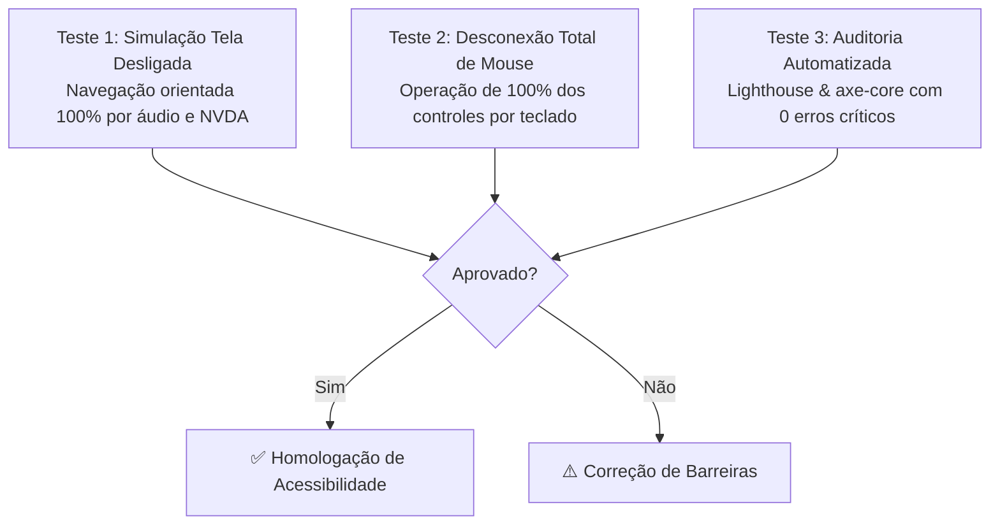

# 08. Acessibilidade e Inclusão Universal

No projeto SONATLAS, a acessibilidade digital não é uma camada adaptativa tardia, mas o **núcleo fundacional da arquitetura de software e da experiência do usuário (UX)**.

A plataforma foi concebida sob os princípios do **Design Universal**, orientando-se estritamente pelas **Diretrizes de Acessibilidade para Conteúdo Web (WCAG) 2.1**, estabelecidas pelo W3C, buscando conformidade em nível **AA** com diversos requisitos atendendo ao nível **AAA**.

---

## 1. Princípio Fundamental de Design

> :octicons-check-circle-16: **PREMISSA DO SONATLAS:**  
> Nenhuma informação meteorológica ou funcionalidade essencial da plataforma pode depender exclusivamente da visão. Se um usuário desligar totalmente o monitor, ele deve conseguir navegar, compreender e interpretar os dados com a mesma acurácia que um usuário vidente.

---

## 2. Pilares de Acessibilidade Implementados

### 2.1. Navegação Exclusiva por Teclado (WCAG 2.1.1, 2.1.2)
- **Operabilidade Total:** Todos os elementos interativos &mdash; seletor de regiões, botões do player, botões da timeline, legenda sonora e links &mdash; são navegáveis e acionáveis via teclado (`Tab`, `Shift + Tab`, `Enter`, `Espaço`, `Setas`).
- **Anel de Foco Visível (`:focus-visible`):** Destaque nítido com borda de 3px em azul ciano (`#38bdf8`) e contraste superior a 3:1 em relação ao fundo escuro.
- **Prevenção de Armadilhas (*Focus Traps*):** Nenhum componente captura o foco do usuário sem permitir sua saída ordenada.
- **Link de Salto (*Skip to Content*):** Primeiro elemento focável na página, permitindo saltar o cabeçalho e ir direto para o player.

### 2.2. Compatibilidade com Leitores de Tela (WCAG 4.1.2, 4.1.3)
Testado e estruturado para plena interoperabilidade com os principais leitores de tela do mercado:
- **NVDA** e **JAWS** no ambiente Windows.
- **VoiceOver** no macOS e iOS.
- **Orca** em distribuições Linux.
- **TalkBack** no ecossistema Android.

#### Preferência de narração falada
Na primeira abertura, o app pergunta se a pessoa deseja ativar narração por voz. A preferência pode ser alterada depois pelo botão **Acessibilidade** no cabeçalho. Quando ativa, a síntese de fala em português lê mudanças manuais de período e mensagens; o controle **Ouvir descrição deste período** permite repetir a descrição científica selecionada. Durante a reprodução contínua, a narração de cada passo é suspensa para não sobrepor a sonificação. Essa opção complementa controles de teclado e leitores de tela, não os substitui. Se o navegador não oferecer `SpeechSynthesis`, a opção fica indisponível e o canal `aria-live` permanece ativo.

#### Estratégia de Regiões Dinâmicas (`aria-live`)
Para evitar a sobrecarga de anúncios que cansam o usuário cego, o SONATLAS utiliza um único canal centralizado com `aria-live="polite"` e `aria-atomic="true"`:
```html
<div role="status" aria-live="polite" aria-atomic="true" class="sr-only">
  Passo 3 de 6: 12 de Outubro, 13:00 UTC. Precipitação forte de 17.3 milímetros por hora cobrindo 85% da Amazônia Central.
</div>
```
A propriedade `polite` garante que o leitor de tela conclua a fala da palavra em curso antes de anunciar a nova métrica, respeitando a cadência do usuário.

### 2.3. Independência do Mapa Cartográfico (WCAG 1.1.1)
- O mapa Leaflet 2D é um recurso complementar para pessoas videntes ou com visão residual.
- Os contêineres de renderização visual e SVGs do mapa recebem `aria-hidden="true"`.
- Um painel de **Audiodescrição Estruturada** acompanha o mapa, fornecendo em texto nativo:
  - Nome formal da região e país.
  - Coordenadas delimitadoras da área (*bounding box*).
  - Resumo contextualizado em linguagem natural da evolução da chuva.

### 2.4. Contraste e Ergonomia Visual (WCAG 1.4.3, 1.4.6)
- **Tema Escuro de Alto Contraste (*Deep Space Theme*):** Cores de fundo em azul profundo (`#090d16` e `#131b2e`) combinadas com texto em branco gelo (`#f1f5f9`), alcançando razão de contraste de **14.2:1** (muito acima do mínimo de 4.5:1 exigido no nível AA).
- Adequado para pessoas com fotofobia, baixa acuidade visual ou daltonismo.

---

## 3. Protocolo de Testes de Acessibilidade

Para assegurar que a experiência sem visão seja rigorosamente funcional, o time de engenharia executa o seguinte protocolo de testes em cada ciclo de release:



### Teste de Validação Prática: Tela Desligada
1. **Condição de Teste:** O avaliador desconecta o monitor ou utiliza uma máscara preta digital sobre a janela do navegador.
2. **Procedimento:**
   - Inicia o navegador e acessa o endereço local da aplicação.
   - Utiliza a tecla `Tab` até a Legenda Sonora e reproduz os três níveis de chuva para calibrar o ouvido.
   - Navega até o seletor de regiões e escolhe a Amazônia Central.
   - Aciona a barra de espaço para tocar a série temporal.
   - Pausa no passo 3 e declara verbalmente: o horário da observação, a taxa de precipitação aproximada e a extensão da chuva.
3. **Critério de Sucesso:** O avaliador extrai com exatidão as informações científicas sem olhar para a tela uma única vez.

---

## 4. Player, Linha do Tempo e Atalhos (implementação)

### 4.1. Política de anúncios (`aria-live`)
Canal único (`AriaLiveAnnouncer`) com dois nós sempre montados: `role="status"` (educado) e `role="alert"` (assertivo, só para dado ausente e erros). A regra anti-spam fica em `frontend/src/utils/announcements.ts`:

| Origem da mudança de passo | Anúncio |
|---|---|
| Foco no slider da linha do tempo | Nenhum (o leitor já lê `aria-valuetext`) |
| Botões, setas, gráfico (manual) | Completo: passo, data/hora UTC, taxa, intensidade, cobertura, disponibilidade |
| Início da reprodução | Curto, com aviso se o passo inicial é ausente ou o áudio está silenciado |
| Avanço automático | Silencioso; alerta assertivo só ao **entrar** em passo sem dados |
| Pausa / fim da série | Resumo do ponto de parada / "Sequência concluída" |

Dado ausente nunca é dito como "0 mm/h"; zero exato é "0.0 mm/h, sem chuva" (dado válido).

### 4.2. Linha do tempo (WAI-ARIA APG, slider)
Uma única parada de `Tab` (`role="slider"`, `aria-valuemin/max/now`, `aria-valuetext` com data/hora UTC e taxa). Teclas: `←/→/↑/↓` (1 passo), `Home/End`, `PgUp/PgDn` (5 passos). Os marcadores visuais são decorativos (`aria-hidden`) e distinguem ausente (ícone, borda tracejada, hachura e texto "Ausente") de zero (rótulo "Sem chuva"), sem depender de cor.

### 4.3. Atalhos globais
`Espaço` reproduz/pausa (nunca sobre botões, links, `summary` ou campos, para não impedir a ativação nativa), `←/→` passo, `Home/End` primeiro/último, `M` mudo, `L` repetir, `?` abre a janela de atalhos (`<dialog>` nativo, `Esc` fecha e o foco volta ao acionador). Combinações com Ctrl/Alt/Meta são ignoradas, exceto `?` via AltGr (teclado ABNT2). Usuários de NVDA/JAWS devem ativar o modo de foco (NVDA + Espaço) para os atalhos de reprodução.

### 4.4. Velocidade, repetição e volume
A velocidade (0,5x a 2x) altera só o intervalo entre passos; frequência e pulsos permanecem os mesmos. Sem repetição, a série para no último passo. O volume controla o ganho mestre do motor, sem alterar frequência, pulsos ou cadência da sonificação. O slider de meteoro funciona por teclado e anuncia o nível selecionado; com o áudio silenciado, ajustar para um nível positivo também reativa o som.

