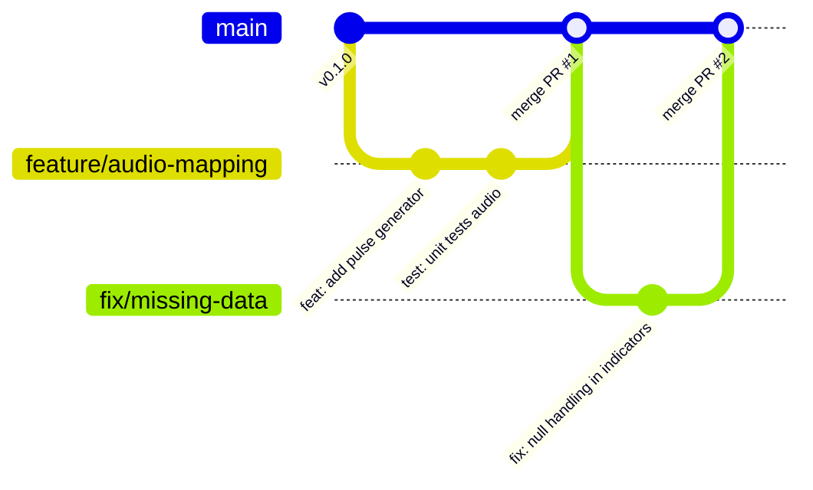

# 11. Guia de Desenvolvimento e Contribuição

Este guia estabelece os procedimentos para instalação do ambiente local, convenções de código, governança de branches e ciclo de submissão de Pull Requests no SONATLAS.

---

## 1. Pré-Requisitos de Sistema

- **Node.js:** Versão 18.x LTS ou superior (recomendado v20+).
- **npm:** Versão 9.x ou superior (ou pnpm).
- **Python:** Versão 3.10 ou superior.
- **Git:** Versão 2.30 ou superior.
- Navegador moderno com suporte à Web Audio API (Chrome, Edge, Firefox ou Safari).

---

## 2. Como Executar o Projeto Localmente

### 2.1. Clonar o Repositório
```bash
git clone https://github.com/sarahgleice/Sonatlas_nasa.git
cd Sonatlas_nasa
```

### 2.2. Executar o Frontend (React + Vite + TypeScript)
```bash
cd frontend
npm install
npm run dev
```
A aplicação web estará disponível em `http://localhost:5173`.

Para verificar a compilação do TypeScript e gerar o pacote de produção:
```bash
npm run build
```

Para rodar os testes unitários do frontend:
```bash
npm run test
```

### 2.3. Executar o Módulo de Processamento Científico (Python)
```bash
cd processing

# Criar ambiente virtual
python -m venv venv

# Ativar ambiente virtual
# No Windows (PowerShell):
.\venv\Scripts\Activate.ps1
# No Linux/macOS:
source venv/bin/activate

# Instalar dependências científicas
pip install -r requirements.txt

# Executar geração e validação de datasets demonstrativos
python scripts/run_pipeline.py --demo

# Executar testes unitários com pytest
pytest tests/
```

### 2.4. Executar o Portal de Documentação (MkDocs Material)
```bash
# Na raiz do repositório:
pip install -r requirements-docs.txt

# Iniciar servidor local de documentação com live reload
mkdocs serve
```
O portal de documentação estará acessível em `http://127.0.0.1:8000`.

Para gerar os arquivos estáticos da documentação na pasta `site/`:
```bash
mkdocs build
```

---

## 3. Padrões de Branches e Versionamento

Adotamos o modelo **GitHub Flow** com nomenclatura semântica estrita:



### Convenção de Nomes de Branch:
- `feature/<nome-da-funcionalidade>`: Desenvolvimento de novas capacidades.  
  *Exemplo:* `feature/web-audio-oscillator`, `feature/congo-bounding-box`
- `fix/<nome-do-ajuste>`: Correção de defeitos em cálculos, áudio ou layout.  
  *Exemplo:* `fix/aria-live-delay`, `fix/cosine-latitude-weight`
- `docs/<nome-da-documentacao>`: Atualização de páginas do portal MkDocs.  
  *Exemplo:* `docs/sonification-math-formulas`, `docs/data-dictionary-update`

---

## 4. Padrões de Mensagens de Commit (Conventional Commits)

Todas as mensagens de commit devem seguir a convenção formal:

```text
<tipo>(<escopo opcional>): <descrição sucinta em minúsculas>
```

### Tipos Permitidos:
- `feat`: Nova funcionalidade para o usuário ou módulo.
- `fix`: Correção de bug ou erro de cálculo/áudio.
- `docs`: Alterações exclusivamente na documentação ou comentários.
- `refactor`: Refatoração interna sem alteração de comportamento.
- `test`: Adição ou modificação de testes automatizados.
- `chore`: Atualização de tarefas de build, dependências ou CI.

### Exemplos Válidos:
- `feat(audio): implementar sintese de onda senoidal com envoltoria adsr`
- `fix(processing): evitar imputacao de zero para celulas sem dado`
- `docs(science): documentar diferenca entre mm/h e mm acumulado`

---

## 5. Fluxo de Submissão e Revisão de Pull Requests (PR)

1. Crie sua branch a partir da `main` atualizada.
2. Certifique-se de que os testes locais passam:
   - Frontend: `npm run build` e `npm run test`.
   - Processamento: `pytest processing/tests/`.
   - Documentação: `mkdocs build`.
3. Abra um Pull Request utilizando o template oficial (`.github/PULL_REQUEST_TEMPLATE.md`).
4. Preencha todos os tópicos do checklist (acessibilidade e rigor científico).
5. Solicite a revisão de pelo menos **um colega técnico**.
6. Após aprovação de todos os checks no GitHub Actions, efetue o merge na `main`.
