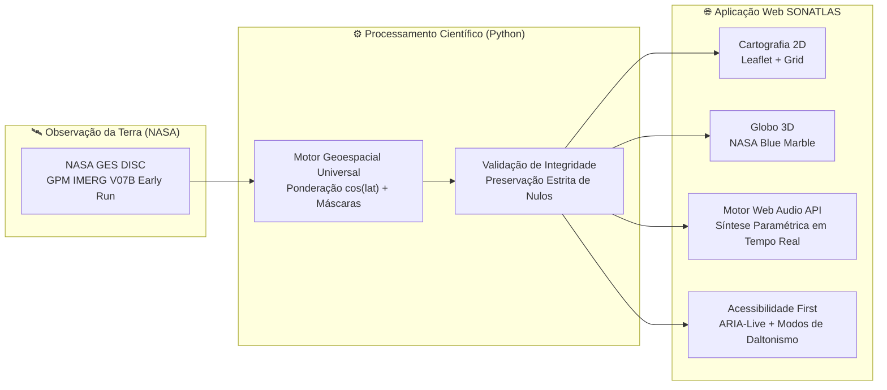

  
    :material-rocket-launch: NASA Space Apps Challenge 2026 &bull; The Earth Information Jukebox
  
  <h1 class="sonatlas-hero-title">SONATLAS</h1>
  
Explore Earth Through Sound

  

    Uma plataforma científica e inclusiva que converte dados de observação da Terra da NASA em experiências auditivas calibradas e multissensoriais. Concebida sob os princípios do <strong>Design Universal</strong> e com prioridade para pessoas cegas ou com baixa visão, tornando fenômenos atmosféricos perceptíveis, mensuráveis e auditáveis por qualquer pessoa.
  

  

    <a href="https://sonatlas-nasa.vercel.app/" target="_blank" rel="noopener noreferrer" class="sonatlas-btn-primary">
      Acessar a Aplicação Web &rarr;
    </a>
    <a href="06-dados-cientificos/" class="sonatlas-btn-secondary">
      Metodologia Científica
    </a>
    <a href="07-sonificacao/" class="sonatlas-btn-secondary">
      Sonificação Psicoacústica
    </a>
    <a href="08-acessibilidade/" class="sonatlas-btn-secondary">
      Acessibilidade Universal
    </a>
    <a href="https://github.com/sarahgleice/Sonatlas_nasa" target="_blank" rel="noopener noreferrer" class="sonatlas-btn-accent">
      GitHub Oficial
    </a>
  

---

## :material-chart-timeline-variant: O Projeto em Números

  

    
750

    
Células Espaciais

    
Grade regular de 0,1° (~11 km) por recorte geográfico analisado.

  

  

    
30 min

    
Cadência Orbital

    
Observações temporais de alta resolução do produto NASA GPM IMERG.

  

  

    
130 a 880 Hz

    
Faixa Psicoacústica

    
Mapeamento logarítmico não-linear do tom de repouso (C3) a tempestades (A5).

  

  

    
WCAG 2.1

    
Nível AA (com AAA)

    
Conformidade AA com contraste aprimorado no padrão AAA e operação com tela desligada.

  

  

    
Zero Streaming

    
Síntese Local

    
Síntese paramétrica pura em tempo real via Web Audio API, sem streaming de áudio.

  

  

    
2 Regiões

    
Estudo Tropical

    
Amazônia Central (piloto verificada) e Bacia do Congo (candidata sob revisão).

  

---

## :material-lightbulb-on: Visão Geral do Projeto

O **SONATLAS** foi desenvolvido para responder ao desafio global **The Earth Information Jukebox** no **NASA Space Apps Challenge 2026**.

Historicamente, a exploração de dados científicos de observação da Terra depende de representações visuais hegemônicas — mapas de calor coloridos (*colormaps*), telas de alta densidade e globos interativos. Essa abordagem cria uma barreira de acesso para mais de **2,2 bilhões de pessoas com deficiência visual** no mundo (OMS) e subutiliza a alta resolução temporal do sistema auditivo humano para reconhecer ritmos, ciclos e padrões complexos.

Ao integrar dados de satélites da NASA, modelagem matemática rigorosa, síntese de áudio paramétrica em tempo real e acessibilidade universal, o SONATLAS transforma grandezas físicas de precipitação em uma narrativa sonora analítica e compreensível.

### Pipeline de Transformação de Dados

---

## :material-earth: Regiões de Estudo e Status de Validação

O SONATLAS adota critérios rigorosos de governança científica. As regiões tropicais analisadas possuem estados de validação distintos, refletindo o grau de verificação e auditoria de cada recorte amostral:

| Região de Estudo | Recorte Geográfico | Grade & Amostragem | Status de Validação | Produto Satelital |
| :--- | :--- | :--- | :--- | :--- |
| **Amazônia Central (Brasil)** | `4.0°S – 1.5°S` `61.5°W – 58.5°W` | Grade regular de 750 células (25×30 a 0,1°) 12 passos temporais de 30 min (duas janelas de 6 passos) | preliminary_verified *Piloto com pipeline e reprodutibilidade auditados* | NASA GPM IMERG V07B Early Run |
| **Bacia do Congo (Kisangani, RDC)** | `0.8°S – 1.7°N` `23.7°E – 26.7°E` | Grade regular de 750 células (25×30 a 0,1°) 6 passos temporais de 30 min (janela vespertina) | candidate_under_review *Janela amostral em avaliação sob revisão técnica* | NASA GPM IMERG V07B Early Run |

> :material-shield-check: **Rigor Científico:**  
> Apenas a região da Amazônia Central possui status de piloto preliminarmente verificado. A janela amostral da Bacia do Congo permanece formalmente como candidata sob revisão técnica, garantindo transparência metodológica e reprodutibilidade científica.

---

## :material-shield-star: Os Quatro Pilares do SONATLAS

  

    :material-satellite-variant:
    <h3 class="sonatlas-pillar-title">1. Dados Científicos Reais da NASA</h3>
    

      Extraídos da missão <strong>GPM IMERG V07</strong> via NASA GES DISC. Distinguimos rigorosamente taxa instantânea ($\text{mm/h}$) de acumulação acumulada ($\text{mm}$). Células sem informação observacional são tratadas como <em>missing data</em> (com tom sonoro de alerta próprio), nunca mascaradas como chuva zero.
    

  

  

    :material-waveform:
    <h3 class="sonatlas-pillar-title">2. Sonificação Psicoacústica Calibrada</h3>
    

      A taxa média ponderada governa a <strong>frequência fundamental</strong> (pitch de 130 Hz a 880 Hz em escala logarítmica), enquanto a fração de área chuvosa modula a <strong>densidade rítmica de pulsos</strong> (de 1 a 7 pulsos por ciclo de 1,5s). Síntese paramétrica pura executada localmente no navegador via Web Audio API.
    

  

  

    :material-human:
    <h3 class="sonatlas-pillar-title">3. Acessibilidade Universal (WCAG 2.1 AA)</h3>
    

      Concebida sob a diretriz de operação orientada a áudio (tela desligada). Navegação por atalhos de teclado, canal centralizado <code>aria-live</code> para leitores de tela, síntese de voz opcional com descrição de períodos, três paletas adaptadas (Padrão, Daltonismo seguro Okabe-Ito e Monocromático) e modos de Alto Contraste.
    

  

  

    :material-map-legend:
    <h3 class="sonatlas-pillar-title">4. Cartografia Multissensorial</h3>
    

      Integração simultânea de mapa cartográfico 2D (Leaflet) com inspeção interativa de células da grade e Globo 3D interativo com textura oficial NASA Blue Marble. Os dados visuais e acústicos permanecem estritamente sincronizados a cada passo temporal de 30 minutos.
    

  

---

## :material-compass: Trilhas de Navegação Institucional

Documentação técnica, científica e institucional estruturada nas quatro áreas do portal:

  <a href="01-visao-produto/" class="sonatlas-card">
    
Institucional &bull; 01

    
Visão do Produto

    
Origem, desafio Space Apps, público-alvo, objetivos estratégicos e proposta de valor.

  </a>

  <a href="06-dados-cientificos/" class="sonatlas-card">
    
Ciência &bull; 06

    
Dados Científicos NASA

    
Metodologia GPM IMERG, cadência de 30 min, ponderação geodésica cos(lat) e integridade de nulos.

  </a>

  <a href="07-sonificacao/" class="sonatlas-card">
    
Ciência &bull; 07

    
Sonificação Psicoacústica

    
Mapeamento físico-acústico, escala logarítmica de pitch, densidade temporal e tons de alerta.

  </a>

  <a href="08-acessibilidade/" class="sonatlas-card">
    
Acessibilidade &bull; 08

    
Inclusão e Baixa Visão

    
Diretrizes WCAG 2.1 AA (contraste AAA), canal aria-live, paleta Okabe-Ito e navegação sem tela.

  </a>

  <a href="09-arquitetura/" class="sonatlas-card">
    
Engenharia &bull; 09

    
Arquitetura de Software

    
Arquitetura desacoplada, Web Audio API, React 18, Leaflet, Three.js e pipeline Python.

  </a>

  <a href="12-equipe/" class="sonatlas-card">
    
Governança &bull; 12

    
Equipe e Governança

    
Equipe de desenvolvedores de software da UNICEPLAC e trajetória no NASA Space Apps Challenge.

  </a>

---

## :material-school: Reconhecimento e Equipe

O **SONATLAS** foi concebido e implementado por uma equipe de estudantes de **Engenharia de Software** representando o **Centro Universitário UNICEPLAC** na etapa presencial de Brasília do **NASA Space Apps Challenge 2026**.

* **Equipe de Desenvolvimento:** UNICEPLAC Software Developers (SONATLAS Team)
* **Desafio Global:** *The Earth Information Jukebox*
* **Repositório de Código Aberto:** [github.com/sarahgleice/Sonatlas_nasa](https://github.com/sarahgleice/Sonatlas_nasa)
* **Aplicação Pública Oficial:** [sonatlas-nasa.vercel.app](https://sonatlas-nasa.vercel.app/)
* **Licença de Uso:** Código aberto sob a [Licença MIT](https://github.com/sarahgleice/Sonatlas_nasa/blob/main/LICENSE)

> :material-information-outline: **Aviso Institucional:**  
> O SONATLAS é um projeto independente desenvolvido por participantes do NASA Space Apps Challenge, não sendo um produto oficial da NASA ou da UNICEPLAC.
