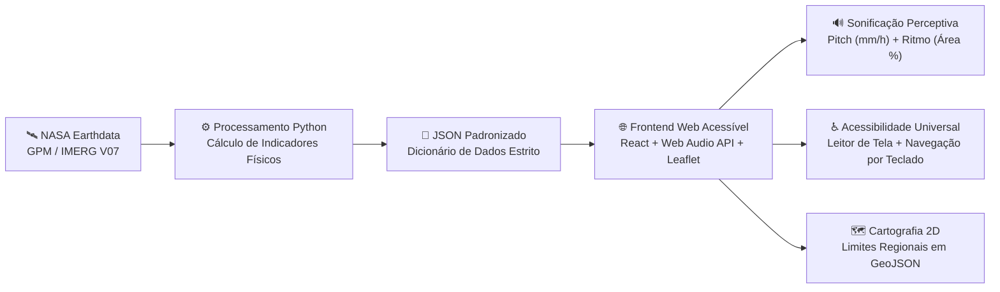

  NASA Space Apps Challenge 2026 &bull; The Earth Information Jukebox
  <h1 class="sonatlas-hero-title">SONATLAS</h1>
  
Explore Earth Through Sound

  

    Uma plataforma web científica e inclusiva que converte dados de satélite da NASA em experiências sonoras dinâmicas. Desenhada com prioridade para pessoas cegas ou com baixa visão, tornando os fenômenos atmosféricos da Terra auditíveis e compreensíveis para todos.
  

  

    <a href="01-visao-produto/" class="sonatlas-btn-primary">
      Conhecer a Visão do Produto &rarr;
    </a>
    <a href="07-sonificacao/" class="sonatlas-btn-secondary">
      Como Funciona a Sonificação
    </a>
    <a href="11-desenvolvimento/" class="sonatlas-btn-secondary">
      Executar o Projeto
    </a>
  

---

## :material-compass-outline: Visão Rápida do Projeto

O **SONATLAS** nasceu para responder ao desafio global **The Earth Information Jukebox**, no âmbito do **NASA Space Apps Challenge 2026**. A iniciativa parte da constatação de que a divulgação e a exploração de dados científicos da Terra dependem quase exclusivamente de telas, globos 3D coloridos e representações visuais, excluindo pessoas com deficiência visual e subutilizando o potencial analítico da audição humana.

Transformamos séries temporais de precipitação da missão **NASA GPM / IMERG** em composições acústicas calibradas perceptivamente, combinadas com navegação cartográfica 2D acessível e audiodescrições detalhadas.

---

## :material-target: Pilares Fundamentais

=== ":material-ear-hearing: Acessibilidade como Princípio Central"
    Projetado sob as diretrizes **W3C WCAG 2.1 (níveis AA e AAA)**. Toda a experiência de exploração dos dados independe do mapa visual: navegação 100% acionável por teclado, regiões `aria-live` sincronizadas, legendas sonoras de calibração e audiodescrições em linguagem natural.

=== ":material-chart-bell-curve: Rigor Científico e Transparência"
    Não inventamos números nem mascaramos incertezas. Distinguimos rigorosamente **taxa instantânea de precipitação (mm/h)** de **acumulação (mm)**. Dados faltantes (*missing data*) nunca são imputados como precipitação zero, preservando a integridade física dos dados observados.

=== ":material-earth: Comparação Bioclimática Global"
    Comparamos a dinâmica de precipitação de duas áreas tropicais essenciais:
    - **Região Nacional:** Amazônia Central (Brasil) &mdash; bacia florestal úmida de alta relevância climática planetária.
    - **Região Internacional:** Bacia do Congo (África Central) &mdash; *área candidata sob validação científica pela equipe*.

---

## :material-grid-large: Navegação Rápida pelo Portal

Explore as seções da documentação oficial do SONATLAS:

  <a href="01-visao-produto/" class="sonatlas-card">
    
Seção 01

    
Visão do Produto

    
Problema, oportunidade, objetivos geral e específicos, escopo do MVP e limites da solução.

  </a>

  <a href="02-personas/" class="sonatlas-card">
    
Seção 02

    
Personas e Usuários

    
Perfis representativos hipotéticos: pessoa cega, estudante, educador e pesquisador científico.

  </a>

  <a href="03-requisitos/" class="sonatlas-card">
    
Seção 03

    
Requisitos do Sistema

    
Requisitos funcionais (RF), não-funcionais (RNF), regras de negócio e matriz de prioridades.

  </a>

  <a href="04-historias-usuario/" class="sonatlas-card">
    
Seção 04

    
Histórias de Usuário

    
Histórias ágeis divididas por épicos, com critérios de aceitação testáveis e rastreabilidade.

  </a>

  <a href="05-metodologia/" class="sonatlas-card">
    
Seção 05

    
Metodologia e Planejamento

    
Contexto do Space Apps 2026, cronograma de sprints, marcos do MVP e responsabilidades da equipe.

  </a>

  <a href="06-dados-cientificos/" class="sonatlas-card">
    
Seção 06

    
Dados Científicos

    
NASA GPM IMERG V07, tratamento de grandezas físicas, ponderação cosseno e ressalvas do EIC.

  </a>

  <a href="07-sonificacao/" class="sonatlas-card">
    
Seção 07

    
Sonificação

    
Mapeamento psicoacústico: frequência tonal (mm/h), densidade rítmica (% de área) e legenda sonora.

  </a>

  <a href="08-acessibilidade/" class="sonatlas-card">
    
Seção 08

    
Acessibilidade

    
Conformidade WCAG 2.1 AA/AAA, leitor de tela, foco de teclado e testes com tela desligada.

  </a>

  <a href="09-arquitetura/" class="sonatlas-card">
    
Seção 09

    
Arquitetura e Tecnologias

    
Arquitetura desacoplada estática, stack tecnológica (React, Vite, Python) e fluxo de dados.

  </a>

  <a href="10-testes/" class="sonatlas-card">
    
Seção 10

    
Testes e Validação

    
Estratégia de testes unitários, validações científicas, testes de acessibilidade e status atual.

  </a>

  <a href="11-desenvolvimento/" class="sonatlas-card">
    
Seção 11

    
Desenvolvimento

    
Guia passo a passo de setup local, padrões de commit, branches e automação de CI/CD.

  </a>

  <a href="12-equipe/" class="sonatlas-card">
    
Seção 12

    
Equipe e Governança

    
Composição dos 5 desenvolvedores, matriz RACI de responsabilidades e rituais de colaboração.

  </a>

