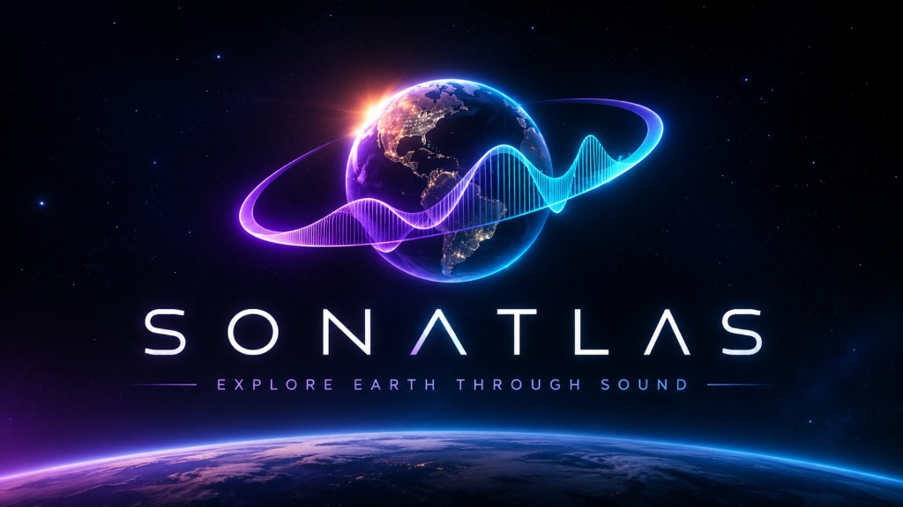
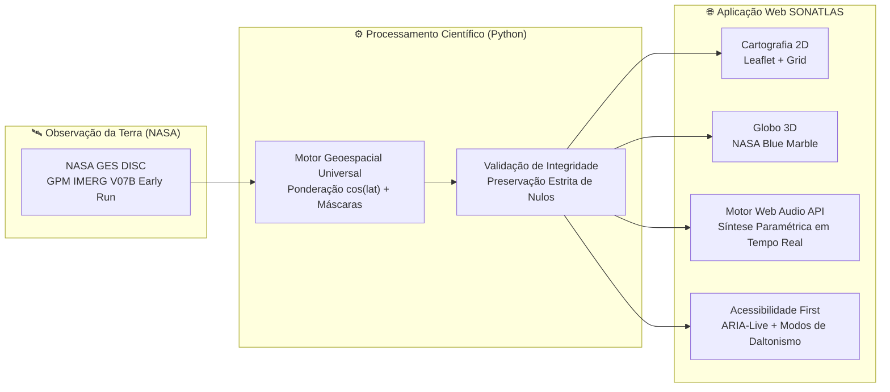

  

  
    :material-rocket-launch: NASA Space Apps Challenge 2026 &bull; The Earth Information Jukebox
  
  <h1 class="sonatlas-hero-title">SONATLAS</h1>
  
Explore Earth Through Sound

  

    Uma plataforma científica e inclusiva que transforma dados de satélite da NASA em experiências auditivas dinâmicas e calibradas. Concebida sob os princípios do <strong>Design Universal</strong>, com foco prioritário em pessoas cegas ou com baixa visão, tornando os fenômenos atmosféricos do planeta perceptíveis, mensuráveis e compreensíveis para todos.
  

  

    <a href="https://sonatlas.vercel.app/" target="_blank" rel="noopener noreferrer" class="sonatlas-btn-primary">
      Acessar a Aplicação Web &rarr;
    </a>
    <a href="06-dados-cientificos/" class="sonatlas-btn-secondary">
      Metodologia Científica
    </a>
    <a href="07-sonificacao/" class="sonatlas-btn-secondary">
      Como Funciona a Sonificação
    </a>
    <a href="08-acessibilidade/" class="sonatlas-btn-secondary">
      Acessibilidade Universal
    </a>
    <a href="https://github.com/sarahgleice/Sonatlas_nasa" target="_blank" rel="noopener noreferrer" class="sonatlas-btn-accent">
      GitHub Oficial
    </a>
  

---

## :material-chart-timeline-variant: O Projeto em Números

  

    
750

    
Células Espaciais

    
Grade regular de 0,1° (~11 km) por recorte geográfico analisado.

  

  

    
30 min

    
Cadência Orbital

    
Observações temporais de alta resolução do produto NASA GPM IMERG.

  

  

    
130 a 880 Hz

    
Faixa Psicoacústica

    
Mapeamento logarítmico não-linear do tom de repouso (C3) a tempestades (A5).

  

  

    
WCAG 2.1

    
Nível AA (com AAA)

    
Conformidade AA com contraste aprimorado no padrão AAA e operação com tela desligada.

  

  

    
Zero Streaming

    
Síntese Local

    
Síntese paramétrica pura em tempo real via Web Audio API, sem streaming de arquivos de áudio.

  

  

    
2 Regiões

    
Estudo Tropical

    
Amazônia Central (piloto verificada) e Bacia do Congo (Kisangani, candidata sob revisão).

  

---

## :material-lightbulb-on: Propósito Científico e Inclusivo

O **SONATLAS** nasceu para responder ao desafio global **The Earth Information Jukebox**, no âmbito do **NASA Space Apps Challenge 2026**.

Historicamente, a divulgação e a exploração de dados científicos de observação da Terra dependem quase exclusivamente de telas brilhantes, mapas de calor coloridos (*colormaps*) e globos 3D interativos. Esse paradigma hegemônico cria uma barreira intransponível para mais de **2,2 bilhões de pessoas com deficiência visual** no mundo (OMS), além de subutilizar a excepcional capacidade temporal do cérebro humano para analisar padrões rítmicos através da audição.

Combinamos **satélites meteorológicos da NASA**, **engenharia de software moderna**, **psicoacústica paramétrica** e **design acessível** para transformar dados numéricos de precipitação em uma narrativa multissensorial completa.

---

## :material-shield-star: Os Quatro Pilares do SONATLAS

  

    :material-satellite-variant:
    <h3 class="sonatlas-pillar-title">1. Dados Científicos Reais da NASA</h3>
    

      Extraídos da missão global <strong>GPM (Global Precipitation Measurement) IMERG V07</strong>. Distinguimos rigorosamente taxa instantânea (mm/h) de precipitação acumulada (mm). Células sem informação observacional são tratadas estritamente como <em>missing data</em> (com tom de alerta próprio), nunca mascaradas artificialmente como chuva zero.
    

  

  

    :material-waveform:
    <h3 class="sonatlas-pillar-title">2. Sonificação Psicoacústica Calibrada</h3>
    

      A taxa média de precipitação determina a <strong>frequência fundamental</strong> (pitch de 130 Hz a 880 Hz em escala logarítmica), enquanto a fração de área chuvosa governa a <strong>densidade rítmica de pulsos</strong> (de 1 a 7 pulsos por janela de 1,5s). O áudio é sintetizado diretamente no navegador, sem arquivos de áudio pré-gravados.
    

  

  

    :material-human:
    <h3 class="sonatlas-pillar-title">3. Acessibilidade Universal (WCAG 2.1 AA)</h3>
    

      Concebida sob o lema <em>"Funciona com a tela desligada"</em>, priorizando pessoas com baixa visão e cegueira. Suporte a leitores de tela com canal centralizado <code>aria-live</code> polite, navegação 100% por atalhos de teclado, legenda sonora de calibração auditiva e <strong>três paletas visuais adaptadas (Padrão, Daltonismo seguro via paleta Okabe-Ito e Monocromático), combináveis com modo de Alto Contraste</strong> (atingindo contraste de até 21:1 na aplicação e 14,2:1 no destaque ciano do portal).
    

  

  

    :material-earth:
    <h3 class="sonatlas-pillar-title">4. Cartografia e Duas Regiões Tropicais</h3>
    

      Exploração de duas regiões de alta relevância climática: a <strong>Amazônia Central</strong> (Brasil, região piloto preliminarmente verificada com 12 passos temporais) e a <strong>Bacia do Congo</strong> (janela amostral de Kisangani, em avaliação sob revisão técnica com 6 passos). Visualização 2D com Leaflet e Globo 3D interativo com textura Blue Marble oficial da NASA.
    

  

---

## :material-compass: Trilhas de Navegação no Portal

Explore a documentação técnica, científica e institucional organizada por áreas de interesse:

  <a href="01-visao-produto/" class="sonatlas-card">
    
Institucional &bull; 01

    
Visão do Produto

    
Origem, desafio Space Apps, público-alvo, objetivos estratégicos, escopo do produto e proposta de valor.

  </a>

  <a href="06-dados-cientificos/" class="sonatlas-card">
    
Ciência &bull; 06

    
Dados Científicos NASA

    
Metodologia GPM IMERG, resolução temporal de 30 min, ponderação geodésica cos(lat) e integridade de nulos.

  </a>

  <a href="07-sonificacao/" class="sonatlas-card">
    
Ciência &bull; 07

    
Metodologia de Sonificação

    
Modelo matemático de conversão física em acústica, escala psicoacústica e tom de advertência de nulos.

  </a>

  <a href="08-acessibilidade/" class="sonatlas-card">
    
Inclusão &bull; 08

    
Acessibilidade e Baixa Visão

    
Diretrizes WCAG 2.1 AA (contraste AAA), canal aria-live, paleta Okabe-Ito, atalhos de teclado e testes sem tela.

  </a>

  <a href="09-arquitetura/" class="sonatlas-card">
    
Engenharia &bull; 09

    
Arquitetura de Software

    
Estrutura desacoplada, Web Audio API, React 18, Leaflet, Three.js, pipeline Python e segurança de dados.

  </a>

  <a href="12-equipe/" class="sonatlas-card">
    
Governança &bull; 12

    
Equipe e Reconhecimento

    
Conheça o time de desenvolvedores de software da UNICEPLAC e a trajetória no NASA Space Apps Challenge.

  </a>

---

## :material-school: Reconhecimento e Equipe

O **SONATLAS** foi concebido e implementado por uma equipe de estudantes de **Engenharia de Software** representando o **Centro Universitário UNICEPLAC** na etapa presencial de Brasília do **NASA Space Apps Challenge 2026**.

* **Equipe de Desenvolvimento:** UNICEPLAC Software Developers (SONATLAS Team)
* **Desafio Global:** *The Earth Information Jukebox*
* **Repositório de Código Aberto:** [github.com/sarahgleice/Sonatlas_nasa](https://github.com/sarahgleice/Sonatlas_nasa)
* **Aplicação Pública Oficial:** [sonatlas.vercel.app](https://sonatlas.vercel.app/)
* **Licença de Uso:** Código aberto sob a [Licença MIT](https://github.com/sarahgleice/Sonatlas_nasa/blob/main/LICENSE)

> :material-information-outline: **Aviso Institucional:**  
> O SONATLAS é um projeto independente desenvolvido por participantes do NASA Space Apps Challenge, não sendo um produto oficial da NASA ou da UNICEPLAC.
